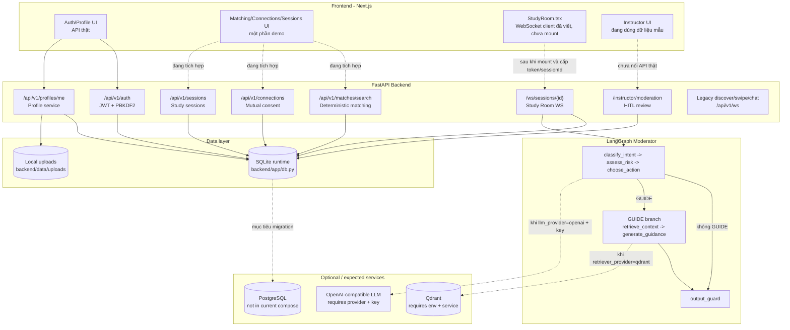
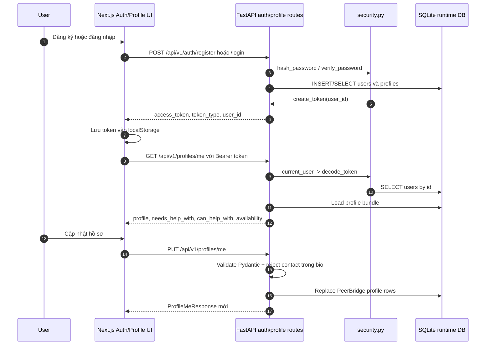
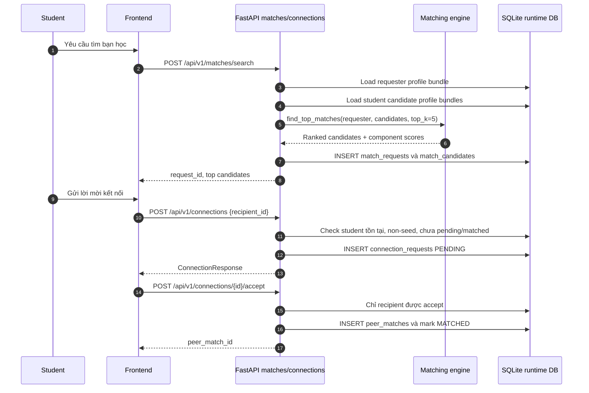
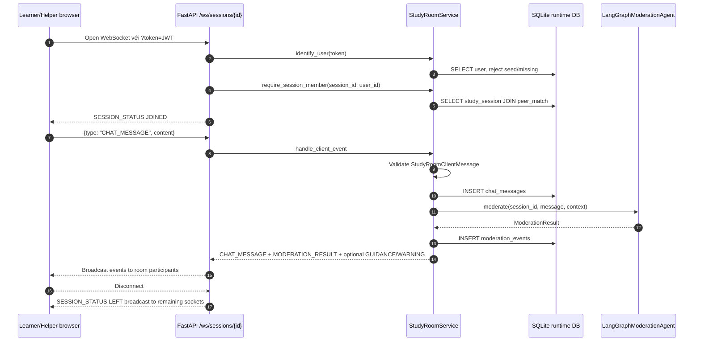
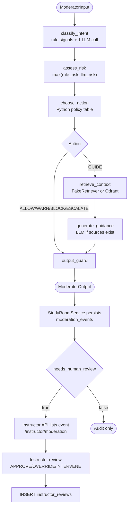
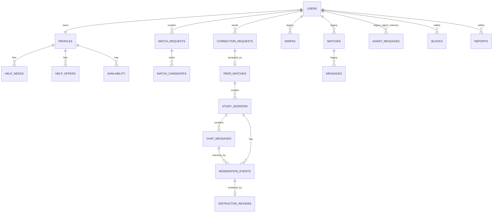
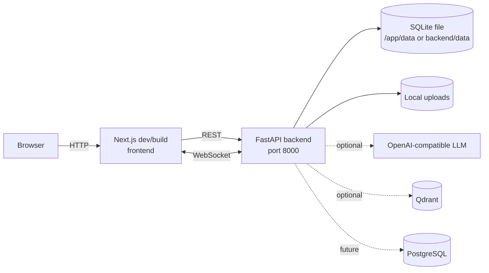

<<<<<<< HEAD
# Kiến trúc PeerBridge — P-005

File gốc ở root được giữ lại theo cấu trúc template BTC. [Sơ đồ Mermaid tại đường dẫn BTC](docs/architecture_diagram.md) và [tài liệu kiến trúc đầy đủ](docs/architecture.md) là hai tài liệu đang được cập nhật cho bản PeerBridge hiện tại. Bản mô tả G2 cũ ở đây đã lỗi thời sau khi frontend, Data 1, Data 2 và AI Vision được tích hợp; có thể xem lại trong lịch sử Git.

## Hiện trạng

- Frontend Next.js trên Vercel gọi API FastAPI trên Render qua REST và WebSocket.
- Backend xử lý tài khoản, ghép cặp có đồng thuận, kế hoạch, check-in, phòng học, thông báo và màn hình admin.
- Moderator và Plan/Coach dùng LangGraph. Check-in ảnh và các luồng AI có chế độ dùng provider thật hoặc chạy giả lập khi thiếu cấu hình; kết quả cần phân biệt theo chế độ.
- Runtime dùng SQLite; RAG hiện dùng BM25 local trên 15 bài học AICB Phase 1. Qdrant/E5 là tùy chọn trong mã nguồn, không phải cấu hình bản demo.
- Render Free dùng đĩa tạm. Litestream/Supabase đã có mã cấu hình nhưng **chưa bật trên bản demo**, nên chưa có cam kết lưu dữ liệu qua lần khởi động lại.

Các endpoint, sơ đồ luồng, giới hạn và đường dẫn code cụ thể được ghi trong [docs/architecture.md](docs/architecture.md).
=======
# PeerBridge - Tài liệu kiến trúc G2

Tài liệu này được cập nhật từ mã nguồn hiện có của PeerBridge: FastAPI backend, Next.js frontend và LangGraph moderation agent. Mục tiêu của bản G2 là mô tả đúng cái đang chạy được trong repo, đồng thời tách riêng kiến trúc dự kiến cho các dịch vụ chưa có bằng chứng vận hành.

## Tóm tắt

PeerBridge là ứng dụng ghép bạn học và hỗ trợ phòng học realtime. Backend FastAPI đang giữ phần xác thực, profile, matching, connection, study session, WebSocket Study Room và moderation/HITL. Frontend Next.js đang có UI PeerBridge, gọi API thật cho Authentication/Profile, có API client cho matching/connections/sessions/moderation, và có component Study Room WebSocket riêng. LangGraph moderator đang có graph thật, nhưng cấu hình mặc định của agent là offline/fake để chạy test và demo không cần dịch vụ ngoài.

Kết luận quan trọng:

- Runtime hiện tại dùng SQLite qua `backend/app/db.py` và các repository `sqlite3`. PostgreSQL là hướng triển khai dự kiến; chưa có service PostgreSQL trong `docker-compose.yml`.
- Moderator mặc định dùng `FakeLLM` và `FakeRetriever`. OpenAI-compatible LLM và Qdrant retriever có code path, nhưng chỉ được kích hoạt bằng env và chưa được chứng minh đang chạy trong compose hiện tại.
- WebSocket Study Room thật nằm ở `/ws/sessions/{session_id}` và đã có test tích hợp. Legacy chat WebSocket `/api/v1/ws` vẫn tồn tại cho demo cũ.
- UI trong `frontend/app/page.tsx` hiện có một số màn hình demo tĩnh; component realtime thật là `frontend/components/StudyRoom.tsx` nhưng chưa được mount thành luồng chính trong `page.tsx`.

## Bằng chứng đã đọc

Nguồn chính trong repo:

- Backend app/router/service: `backend/app/main.py`, `backend/app/routers/*.py`, `backend/app/services/*.py`, `backend/app/repositories/*.py`.
- Database runtime: `backend/app/db.py`.
- SQLAlchemy/Alembic layer: `backend/app/database.py`, `backend/app/models.py`, `backend/alembic/`.
- Moderator LangGraph: `backend/app/agents/moderator/graph.py`, `nodes/`, `llm.py`, `openai_llm.py`, `retriever.py`, `qdrant_retriever.py`, `settings.py`, `hitl.py`.
- Frontend: `frontend/app/page.tsx`, `frontend/lib/api.ts`, `frontend/components/StudyRoom.tsx`.
- Tests liên quan: `backend/tests/test_profiles_api.py`, `test_matches_api.py`, `test_connections_api.py`, `test_sessions_api.py`, `test_study_room_ws.py`, `test_instructor_moderation_api.py`, `test_moderator_graph.py`.

## Hiện trạng chạy và kiến trúc dự kiến

| Mảng | Đang chạy trong repo hiện tại | Kiến trúc dự kiến / tùy chọn | Ghi chú không tuyên bố quá mức |
| --- | --- | --- | --- |
| Frontend | Next.js/React trong `frontend`; auth/profile gọi API thật; các màn hình matching/connections/sessions/moderation trong `page.tsx` còn nhiều dữ liệu demo | Nối các màn hình vào API thật và mount `StudyRoom.tsx` trong luồng session | `StudyRoom.tsx` có WebSocket client thật, nhưng chưa thấy được import/mount trong `page.tsx` |
| Backend | FastAPI, routers REST + WebSocket, rate limit middleware, CORS, static uploads | Có thể tách worker/runtimes riêng khi production | `docker-compose.yml` hiện chỉ khai báo backend |
| Database runtime | SQLite file qua `DATABASE_PATH` và `sqlite3` repositories | PostgreSQL qua `DATABASE_URL`, SQLAlchemy models và Alembic migrations | Route/service chính hiện dùng `backend/app/db.py`, không phải SQLAlchemy session |
| Auth | JWT HS256 từ `JWT_SECRET`, password hash PBKDF2 | Bổ sung email verification, secret manager, user management cho instructor | Không có public instructor registration; role instructor cần được tạo trong DB/admin |
| Matching | Deterministic scoring Python: skill complementarity, topic compatibility, availability overlap, preference compatibility | Có thể thêm explanation bằng LLM sau khi score đã ổn định | Không thấy LLM tham gia scoring/decision trong luồng `/api/v1/matches/search` |
| Realtime Study Room | `/ws/sessions/{session_id}` xác thực token, kiểm tra thành viên session, persist chat, gọi moderation, broadcast events | Có thể thêm pre-delivery blocking, Redis/pubsub cho multi-instance | Hiện `BLOCK` là moderation action/event; message vẫn được persist và broadcast trong event batch |
| Moderator LLM | Mặc định `LLM_PROVIDER=fake`; nếu `openai` mà thiếu key thì fallback FakeLLM | OpenAI-compatible `/chat/completions` qua `OpenAICompatibleLLM` | Không khẳng định OpenAI đang hoạt động nếu không có env/key và log/thực nghiệm |
| Retriever/RAG | Mặc định `RETRIEVER_PROVIDER=fake`; FakeRetriever mặc định không có tài liệu | Qdrant + E5 embedding khi `RETRIEVER_PROVIDER=qdrant` | Không có Qdrant service trong compose hiện tại; cần ingest/collection riêng |
| HITL | `moderation_events` và `instructor_reviews` lưu SQLite; API instructor được bảo vệ bằng role | Dashboard instructor nối API thật, workflow review áp dụng vào session | API review đã lưu audit; UI instructor hiện trong `page.tsx` còn demo |

## Sơ đồ tổng thể

## Thành phần chính

### Frontend

Frontend nằm trong thư mục `frontend`.

- `app/page.tsx` là shell UI chính: auth screen, dashboard, matching, connections, sessions, profile, moderation, analytics, architecture.
- Auth/Profile gọi backend thật qua `lib/api.ts`: register, login, get profile, update profile.
- Token JWT được lưu trong `localStorage` với key `peerbridge_token`.
- Matching/Connections/Sessions/Moderation UI trong `page.tsx` hiện còn dùng dữ liệu demo và toast local ở nhiều chỗ.
- `components/StudyRoom.tsx` xử lý WebSocket thật cho `/ws/sessions/{session_id}`: parse event `SESSION_STATUS`, `CHAT_MESSAGE`, `MODERATION_RESULT`, `GUIDANCE`, `WARNING`, `ERROR`.

### Backend

Backend FastAPI khởi tạo trong `backend/app/main.py`.

- Lifespan gọi `init_db()` và `seed_profiles()`.
- Routers có prefix `/api/v1`: auth, profiles, discovery, interactions, matches, connections, sessions, moderation safety, chat legacy.
- Study Room WebSocket được include không prefix API: `/ws/sessions/{session_id}`.
- Instructor moderation được include không prefix API: `/instructor/moderation`.
- Runtime DB chính của các route là `sqlite3` qua context manager `database()`.

Endpoint G2 quan trọng:

| Chức năng | Endpoint hiện có |
| --- | --- |
| Đăng ký | `POST /api/v1/auth/register` |
| Đăng nhập | `POST /api/v1/auth/login` |
| Hồ sơ của tôi | `GET /api/v1/profiles/me` |
| Cập nhật hồ sơ | `PUT /api/v1/profiles/me` |
| Upload avatar | `POST /api/v1/profiles/me/avatar` |
| Tìm match | `POST /api/v1/matches/search` |
| Đọc kết quả match request | `GET /api/v1/matches/{request_id}` |
| Danh sách connection | `GET /api/v1/connections` |
| Gửi lời mời kết nối | `POST /api/v1/connections` |
| Chấp nhận/từ chối | `POST /api/v1/connections/{id}/accept`, `POST /api/v1/connections/{id}/reject` |
| Tạo/xem study session | `POST /api/v1/sessions`, `GET /api/v1/sessions/{session_id}` |
| Study Room realtime | `WS /ws/sessions/{session_id}?token=...` |
| Hàng đợi HITL | `GET /instructor/moderation` |
| Review HITL | `POST /instructor/moderation/{moderation_event_id}/review` |

## Luồng 1 - Authentication/Profile

Giải thích:

- `POST /auth/register` tạo user và profile cơ bản. Role mặc định của DB là `STUDENT`.
- `POST /auth/login` từ chối seed user và kiểm tra password hash PBKDF2.
- JWT là token HS256 từ `JWT_SECRET`; nếu thiếu `JWT_SECRET`, backend không thể tạo/kiểm tra token đúng cách.
- Profile API trả một bundle gồm `profile`, `needs_help_with`, `can_help_with`, `availability`.
- `PUT /profiles/me` chấp nhận schema PeerBridge mới hoặc schema legacy; đường PeerBridge mới xóa và insert lại needs/offers/availability.
- Frontend auth/profile đang gọi API thật. Role switch trên UI không thay thế authorization backend.

## Luồng 2 - Matching/Connections

Giải thích:

- Matching hiện tại là deterministic scoring, không dùng LLM để quyết định score.
- Hard filter loại chính user và yêu cầu ít nhất một topic match giữa `needs_help_with` của requester và `can_help_with` của candidate.
- Component score hiện có:
  - `skill_complementarity`: 45%
  - `topic_compatibility`: 20%
  - `availability_overlap`: 25%
  - `preference_compatibility`: 10%
- Kết quả search được persist vào `match_requests` và `match_candidates`, owner-scoped theo requester.
- Connection API enforce mutual consent: requester tạo PENDING, recipient mới được accept/reject, accept tạo `peer_matches`.
- Lưu ý hiện trạng: `ProfileRepository.list_student_profile_bundles()` lọc role `STUDENT` nhưng không loại `is_seed`; connection target lại yêu cầu non-seed. Nếu dùng seed data cho demo, cần cảnh giác trường hợp candidate seed không tạo connection được.

## Luồng 3 - Study Room WebSocket

Giải thích:

- WebSocket hợp lệ khi token decode được và user là learner/helper của `study_sessions`.
- Client chỉ được gửi event JSON dạng `{ "type": "CHAT_MESSAGE", "content": "..." }`; payload rỗng/sai trả `ERROR`.
- Backend persist chat message trước khi gọi moderation. Test `test_study_room_websocket_persists_chat_message_before_moderation` xác nhận hành vi này.
- Backend lưu moderation event với action, risk, reason, guidance, `needs_human_review` và context.
- Events broadcast:
  - `SESSION_STATUS`
  - `CHAT_MESSAGE`
  - `MODERATION_RESULT`
  - `GUIDANCE` nếu action `GUIDE` có guidance
  - `WARNING` nếu action `WARN`, `BLOCK` hoặc `ESCALATE`
  - `ERROR` cho payload/processing error
- Hiện trạng không phải pre-moderation blocking tuyệt đối: kể cả action `BLOCK`, service vẫn tạo `CHAT_MESSAGE` event trong batch trả về. Nếu G2/production yêu cầu "block before delivery", cần đổi `StudyRoomService.handle_client_event()`.

## Luồng 4 - LangGraph Moderation/HITL

Giải thích:

- Graph thật được build bằng `StateGraph(ModeratorState)`:
  - `START -> classify_intent -> assess_risk -> choose_action`
  - chỉ action `GUIDE` mới đi qua `retrieve_context -> generate_guidance`
  - mọi nhánh kết thúc qua `output_guard -> END`
- `classify_intent` kết hợp rule-based signals với LLM JSON. Tín hiệu hard/rule không bị LLM hạ risk tùy tiện.
- `assess_risk` là code Python, không gọi LLM thêm.
- `choose_action` là policy table:
  - risk >= threshold -> `ESCALATE`
  - harmful -> `BLOCK`
  - academic dishonesty -> `ESCALATE`
  - answer sharing -> `WARN` hoặc `BLOCK`
  - solution request -> `GUIDE`
  - concept/social -> `ALLOW`
  - off-topic risk cao -> `WARN`
- Fail-safe: nếu graph hoặc dependency lỗi, output thành `ESCALATE`, risk 1.0, `needs_human_review=true`.
- Study Room service đang map `ModeratorOutput` về `ModerationResult`, sau đó lưu vào `moderation_events`.
- `backend/app/agents/moderator/hitl.py` có DTO/hàng đợi HITL in-memory cho test/agent layer, nhưng service runtime cho Study Room đang dùng `ModerationRepository` để lưu event/review SQLite.
- Instructor API chỉ cho user role `INSTRUCTOR`; review được lưu vào `instructor_reviews`.

## Data model hiện có

Bảng runtime nằm trong SQLite schema `backend/app/db.py`, gồm cả bảng PeerBridge mới và legacy demo. SQLAlchemy models trong `backend/app/models.py` và Alembic migrations tương ứng đã tồn tại, nhưng các route/service G2 hiện đang thao tác qua `sqlite3`.

Bảng PeerBridge mới quan trọng:

- `users`, `profiles`
- `help_needs`, `help_offers`, `availability`
- `match_requests`, `match_candidates`
- `connection_requests`, `peer_matches`
- `study_sessions`, `chat_messages`
- `moderation_events`, `instructor_reviews`

Bảng legacy/demo còn tồn tại:

- `swipes`, `matches`, `messages`
- `agent_messages`
- `blocks`, `reports`

## Cấu hình runtime

| Biến môi trường | Mặc định trong code | Ảnh hưởng |
| --- | --- | --- |
| `DATABASE_PATH` | `./data/dongdieu.db` | SQLite file cho `backend/app/db.py` |
| `DATABASE_URL` | rỗng | SQLAlchemy/Alembic URL; nếu rỗng fallback về SQLite URL từ `DATABASE_PATH` |
| `JWT_SECRET` | rỗng | Bắt buộc để tạo/verify JWT |
| `UPLOAD_DIRECTORY` | `./data/uploads` | Nơi lưu avatar local |
| `LLM_PROVIDER` | `fake` | `fake` hoặc `openai` cho moderator |
| `LLM_API_KEY` / `OPENAI_API_KEY` | rỗng | Key cho OpenAI-compatible LLM; thiếu key thì fallback FakeLLM |
| `LLM_MODEL` | `gpt-4.1-mini` | Model khi dùng provider OpenAI-compatible |
| `RETRIEVER_PROVIDER` | `fake` | `fake` hoặc `qdrant` |
| `QDRANT_URL` | `http://localhost:6333` | Chỉ dùng khi retriever provider là `qdrant` |
| `QDRANT_COLLECTION` | `course_materials` | Collection RAG |
| `EMBEDDING_MODEL` | `intfloat/multilingual-e5-large` | E5 embedder khi dùng Qdrant |

## PostgreSQL, OpenAI và Qdrant

### SQLite vs PostgreSQL

- Đang chạy: SQLite file qua `backend/app/db.py`, `sqlite3.connect`, `PRAGMA foreign_keys=ON`, `journal_mode=WAL`.
- Có sẵn cho tương lai: SQLAlchemy `Base`, models và Alembic migrations; `get_settings().sqlalchemy_database_url` có thể lấy `DATABASE_URL`.
- Chưa có bằng chứng: backend routes chính chưa dùng SQLAlchemy session, compose chưa khai báo PostgreSQL. Vì vậy không nên ghi "dữ liệu đang lưu trong PostgreSQL" cho G2 hiện tại.

### FakeLLM vs OpenAI

- Đang chạy mặc định: `LLM_PROVIDER=fake`, `neutral_fake_llm()`.
- Nếu `LLM_PROVIDER=openai` và có key: dùng `OpenAICompatibleLLM` gọi endpoint `/chat/completions` với JSON mode.
- Nếu đặt OpenAI nhưng thiếu key: code log warning và fallback FakeLLM.
- Chưa có bằng chứng: không có test/evidence rằng OpenAI production đang được gọi thành công trong môi trường hiện tại.

### FakeRetriever vs Qdrant

- Đang chạy mặc định: `RETRIEVER_PROVIDER=fake`; FakeRetriever lọc tài liệu in-memory theo keyword overlap. Mặc định không nạp course documents.
- Nếu `RETRIEVER_PROVIDER=qdrant`: code build `QdrantRetriever`, `QdrantClient`, E5 embedder, collection `course_materials`.
- Chưa có bằng chứng: `docker-compose.yml` không có Qdrant service; cần ingest documents và chạy Qdrant riêng trước khi nối RAG thật.

## Deployment hiện có

`docker-compose.yml` hiện trỏ đến `Dockerfile` ở thư mục gốc (context `.`), expose port 8000, mount `./data:/app/data`, đọc `.env` và kiểm tra `/health`. Do `Dockerfile` gốc còn thuộc template AI20K, chưa coi compose này là cách triển khai PeerBridge đã được kiểm thử. Compose không khai báo frontend, PostgreSQL, Redis hay Qdrant.

## Giới hạn hiện tại cần nêu trong G2

- Auth/Profile đã nối API thật trên frontend; matching/connections/sessions/moderation UI chính trong `page.tsx` còn là demo UI ở nhiều nút bấm.
- `StudyRoom.tsx` là component realtime thật nhưng chưa được tích hợp vào navigation/session flow chính.
- Role instructor được backend enforce, nhưng chưa có public flow tạo instructor account.
- Moderator mặc định offline/fake. RAG thật cần Qdrant service, collection, ingest và env.
- `BLOCK`/`ESCALATE` trong Study Room hiện là moderation event sau khi message đã được lưu/phát; chưa phải message gate ngăn phát tán nội dung.
- PostgreSQL là kiến trúc dự kiến/migration target, không phải runtime mặc định hiện tại.

## Hướng tiếp theo sau G2

1. Nối UI matching/connections/sessions/moderation vào API thật thay cho dữ liệu demo.
2. Mount `StudyRoom.tsx` trong màn hình session và cấp `sessionId` từ `/api/v1/sessions`.
3. Quyết định semantic của `BLOCK`: nếu cần chặn trước khi phát, đổi service để moderate trước broadcast.
4. Tạo luồng/admin script cho instructor account và test end-to-end HITL trên UI.
5. Nếu cần production DB, migrate route/service sang SQLAlchemy hoặc repository tương thích PostgreSQL; cập nhật compose/deploy có PostgreSQL.
6. Nếu cần RAG thật, thêm Qdrant service, ingest course docs, bật `RETRIEVER_PROVIDER=qdrant` và đo retrieval quality.
7. Nếu cần LLM thật, cấu hình `LLM_PROVIDER=openai`, key, timeout, retry và quan sát log/fallback.
>>>>>>> 29066618049be865e9daa585fed068c149bc780f
