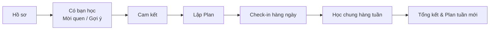

# PeerBridge AI: Mô tả tính năng sản phẩm

> **Bản nháp cho team** · Ngày: 10/10/2026  
> *Lưu ý*: Các số liệu đánh dấu `[giả định]` do team đặt tay, cần chỉnh sửa và hiệu chỉnh lại theo dữ liệu thực tế từ đợt pilot.

---

## 1. Cách đọc tài liệu
* Tài liệu mô tả **sản phẩm làm gì**, **AI làm gì ở từng phần**, và **các tình huống đặc biệt được xử lý thế nào**.
* Chi tiết thuật toán và tiêu chí ghép cặp xem tại *PRD ghép cặp*.
* Phần ghi chú phản biện dành cho PO nằm ở **Mục 7**.

---

## 2. Painpoint chính
*Hiện tại chưa có nghiên cứu sâu về người dùng. Các painpoint dưới đây được rút ra từ một số cuộc phỏng vấn ngắn nên đều là giả thuyết cần kiểm chứng:*

| # | Painpoint | Sản phẩm giải bằng | Mức bằng chứng |
| :--- | :--- | :--- | :--- |
| **P1** | Muốn có người học cùng nhưng ngại chủ động tìm, thử vài lần rồi thôi | Mời bạn quen bằng link. Gợi ý người phù hợp khi chưa có ai | Tín hiệu từ vài phỏng vấn |
| **P2** | Kế hoạch vỡ khi lịch trường chen vào, không ai chờ kết quả nên dễ bỏ | Plan co giãn, cặp cam kết, coach nhắc | Tín hiệu từ vài phỏng vấn |
| **P3** | AI trả lời được kiến thức nhưng người học không biết nên tập trung phần nào | Plan có bước chọn ưu tiên và cắt nội dung | Giả thuyết |
| **P4** | Trao đổi xong tưởng mình hiểu nhưng sau đó hiểu sai | Buổi học chung có tự kiểm tra độc lập | 1 tín hiệu, có nghiên cứu nền chưa kiểm chứng với người dùng |

---

## 3. Tổng quan sản phẩm
Sản phẩm giúp sinh viên học cùng một bạn (cặp 2 người) để giữ nhịp học cho một mục tiêu có mốc thời gian. 
* Mỗi người có plan riêng, hai người chung nhịp và có một buổi học chung mỗi tuần.
* Một người có thể tham gia tối đa **2 cặp** `[giả định]`.

### Luồng chính (Core Journey):

---

## 4. AI làm gì ở từng phần

### Nguyên tắc phân định (Code vs. AI):
* **Code**: Tính toán định lượng và quyết định **khi nào** can thiệp (deterministic logic, triggers, thresholds).
* **AI**: Viết nội dung và **chọn trong danh sách hành động cho phép** (constrained generation).
* **Quyền kiểm soát**: Mọi thay đổi plan do AI đề xuất đều **cần người dùng xác nhận** một chạm.

| Phần | AI làm | Code làm |
| :--- | :--- | :--- |
| **Ghép cặp** | Trích đặc điểm từ phần giới thiệu, xếp lại và viết lý do ghép | Lọc, tính điểm, tạo cặp |
| **Plan** | Chia mục tiêu thành việc, viết ba mức mỗi việc, viết dạng *"Nếu… thì…"* | Xếp lịch, tính đệm, kiểm tra tổng giờ |
| **Coach** | Chọn hành động và viết lời nhắc | Quyết định khi nào can thiệp |
| **Học chung** | Gợi ý mục tiêu buổi, câu kiểm, gợi ý theo bậc, tổng kết | Bấm giờ, ghi kết quả |

---

### 4.1 Ghép cặp
* **Hai đường vào**:
  1. *Mời bạn quen bằng link* (đường chính, không cần thuật toán ghép).
  2. *Gợi ý người lạ* (dự phòng).
* **Tiêu chí gợi ý từ hồ sơ**:
  * Mức của mốc: **Gấp** (<2 tuần), **Vừa** (2 tuần – 2 tháng), **Dài** (>2 tháng).
  * Giờ cam kết học.
  * Phong cách và mong muốn rút trích từ văn bản giới thiệu.
  * Concept học tập.
  * *Cam kết*: **Không dùng** giới tính, trường, ngành để lọc/ghép.
* **Số lượng gợi ý**: Từ 5 đến 20 ứng viên tùy dung lượng pool người dùng.

#### Xử lý tình huống đặc biệt trong Ghép cặp:
* **Pool nhỏ, ít người hợp**: Bổ sung người điểm cao kế tiếp cho đủ 5, gắn nhãn `[Chưa chắc]`. Sau 24 giờ không ai đạt từ 0.50 điểm thì gợi ý mời bạn quen hoặc team ghép tay.
* **Hồ sơ ngắn hoặc để trống**: Thông tin thiếu ghi `Chưa rõ` và không bị trừ điểm.
* **Hai bên không phản hồi**: Lời mời hết hạn sau 48 giờ, hệ thống tự gợi ý người kế tiếp.
* **Người đã có bạn**: Chỉ xuất hiện khi họ bật *"Tìm thêm bạn"*. Đã đủ số bạn tối đa (2 cặp) thì không xuất hiện trong gợi ý của người khác.

---

### 4.2 Plan (Kế hoạch học tập 3 tầng & Co giãn)
* Mỗi người có một plan gắn với mục tiêu và deadline mốc thời gian.
* **Cấu trúc việc học (AI chia nhỏ)**:
  * Thời lượng: 30 đến 90 phút/việc.
  * Mỗi việc có tiêu chí hoàn thành rõ ràng và **3 mức thực hiện**:
    1. **Tối thiểu** (10 – 15 phút): Chỉ cần làm xong mức này là được tính 1 ngày đạt tiến độ.
    2. **Mục tiêu**: Khối lượng chuẩn theo ngày.
    3. **Nâng cao**: Mở rộng bài tập/kiến thức sâu.
  * **Định dạng triển khai**: Viết dạng *"Nếu [19h thứ Ba ở thư viện] thì [làm 5 bài JOIN]"*.
* **Code xử lý**: Xếp việc vào khung giờ rảnh của người dùng, chừa sẵn đệm an toàn **20% đến 30%** `[giả định]`.
* Người dùng xem bản nháp, có quyền chỉnh sửa và bấm **Cam kết**.

#### Ba loại Plan theo Mốc thời gian:
| Loại Plan | Cách lập | Cách hiển thị |
| :--- | :--- | :--- |
| **Gấp** *(Dưới 2 tuần)* | Cắt nội dung trước (chia: Bắt buộc, Nên có, Bỏ). Không tăng dần khối lượng. | Lịch chi tiết theo từng ngày. |
| **Vừa** *(2 tuần – 2 tháng)* | Tuần đầu nhẹ nhàng rồi tăng dần. Bố trí **1 ngày dự phòng** mỗi tuần. | Mục tiêu theo tuần, việc linh hoạt. |
| **Dài** *(Trên 2 tháng)* | Vài mốc chính và mức tối thiểu mỗi tuần. Mỗi tuần chọn 2 đến 3 khung giờ cụ thể. | Mốc chính, kiểm lại sau 2 đến 4 tuần. |

#### Xử lý tình huống với Plan:
* **Tuần có lịch biến động nhiều**: Đầu tuần gửi câu hỏi một chạm *"Tuần này bạn bận mức nào?"* (Nhẹ, Vừa, Nặng). Hệ thống tự tăng/giảm lượng việc tương ứng.
* **Chưa có / Chưa nhập khung giờ rảnh**: Không ép buộc. Chỉ đề xuất "ngày tối thiểu" 10–15 phút và nhắc lại khi người dùng mở app.
* **Hủy hoặc lỡ 1 việc học**: Cung cấp **3 lựa chọn một chạm**:
  1. *Làm bản rút gọn (mức tối thiểu)*
  2. *Dời ngày* (rơi vào ngày dự phòng của tuần)
  3. *Bỏ có chủ đích*  
  *(Kèm thẻ chọn lý do: Lịch trường, Mệt, Quên, Hết hứng, Khác).*
* **Dời lần thứ 2 cùng một việc**: Bắt buộc chọn *Rút gọn* hoặc *Bỏ có chủ đích*, không cho phép dời tiếp.
* **Hủy hoặc lỡ 3 việc liên tiếp**: Đề xuất plan tuần nhẹ hơn (giảm 20% lượng việc, cắt bỏ phần ưu tiên thấp) để người dùng xác nhận. Nếu trượt 2 tuần liên tiếp thì hỏi đổi mốc, đổi mục tiêu hoặc tạm dừng.
* **Deadline trường đột xuất**: AI tách nhỏ, giữ lại phần bắt buộc, chuyển phần còn lại vào danh sách *"Để sau"*.
* **Mốc deadline đến gần mà tiến độ còn thấp**: Tự động chuyển sang chế độ cắt giảm nội dung, nói rõ phần nào sẽ bỏ.

---

### 4.3 Coach: Đo tiến độ & Nhắc nhở nhân văn

#### Chỉ số Pacing:
$$\text{Pacing} = \frac{\text{Tổng giờ ước lượng của việc đã xong}}{\text{Tổng giờ ước lượng của việc đáng lẽ phải xong đến hôm nay}}$$
* $\text{Pacing} = 1.0$: Hoàn toàn đúng tiến độ.
* $\text{Pacing} < 0.7$: Trễ tiến độ đáng kể `[giả định]`.
* Check-in hằng ngày: Chỉ cần **một chạm** đánh dấu Đạt / Chưa đạt. Đính kèm ảnh là tùy chọn không bắt buộc.

#### Giới hạn & Quy tắc an toàn của AI Coach:
* **Tần suất**: Tối đa **1 tin nhắn / người / ngày**.
* **Khung giờ cấm (Blackout hours)**: Tuyệt đối không gửi từ **22:00 đến 07:00**.
* **Thái độ giao tiếp**:
  * Không đổ lỗi, không tạo áp lực tiêu cực.
  * Không so sánh hai người học với nhau.
  * Mỗi tin luôn gợi ý một việc nhỏ có thể làm được ngay (10–15 phút).

#### Ma trận kích hoạt Coach:
| Tín hiệu kích hoạt | Hành động của Hệ thống & AI |
| :--- | :--- |
| **2 ngày không check-in** | Nhắc riêng nhẹ nhàng, gợi ý kích hoạt *"Ngày tối thiểu"*. |
| **Pacing 1 người < 0.7** | Đề xuất plan tuần nhẹ hơn để phục hồi nhịp học. |
| **Pacing cả 2 người < 0.7** | Đề xuất hạ tải plan cho cả cặp và gợi ý một buổi học chung ngắn. |
| **Pacing 2 người lệch > 0.3** | Nhắc người chậm, gợi ý bạn học gửi tin hỏi thăm. **Không hiển thị ai tệ hơn**. |
| **Cả tuần bị trễ nhịp** | Sáng thứ Hai gửi thông điệp *"Tuần mới, bắt đầu lại"* kèm plan nhẹ hơn. |
| **Xong mức tối thiểu** | Vẫn tính là 1 ngày đạt, gửi tin ghi nhận ngắn gọn. |
| **3 tin liên tiếp không mở** | Tự động giảm tần suất nhắc nhở, chuyển sang tóm tắt gộp vào cuối tuần. |

---

### 4.4 Học chung hàng tuần (3-Phase Study Room)
* Tần suất: **Mỗi tuần 1 buổi**, thời lượng linh hoạt: 25, 50 hoặc 75 phút.
* Lịch học được chốt vào đầu tuần: Một người đề xuất từ khung giờ chung, người kia bấm đồng ý.

#### Quy trình 3 giai đoạn của buổi học:
| Giai đoạn | Người dùng làm | AI làm |
| :--- | :--- | :--- |
| **Trước buổi** *(~2 phút)* | Đặt mục tiêu buổi trong 1 câu; Chia vai ai giải thích phần nào; Tự chấm mức độ tự tin. | Gợi ý mục tiêu buổi, phân chia vai và tạo **2–3 câu kiểm tra** từ plan của 2 người. Người hướng dẫn được thêm/sửa câu và xem kết quả. |
| **Trong buổi** | Người học tự giải thích lại bài bằng lời của mình; Hai người trả lời riêng 1 câu hỏi, thảo luận, rồi trả lời lại. | **Chạy ở nền**: Bấm giờ, nhắc mốc thời gian (đầu, giữa, cuối buổi), kiểm tra tiến độ so với mục tiêu. Gợi ý câu hỏi đào sâu; Gợi ý theo bậc gợi mở, **không đưa sẵn đáp án khi chưa được hỏi**. |
| **Sau buổi** *(~3 phút)* | Tự trả lời câu kiểm độc lập một mình; Xem tổng kết buổi học. | Tổng kết: Đã học được gì, sai ở đâu, có chậm nhịp không. Phần chưa vững tự động nạp vào plan tuần sau. Hẹn câu hỏi ôn tập sau 2–3 ngày. |

> *Nguyên tắc cốt lõi: AI không giải thích thay sinh viên. Giá trị buổi học nằm ở sự tương tác và tự diễn giải giữa 2 người bạn.*

#### Xử lý tình huống trong buổi học chung:
* **Không tìm được khung giờ chung**: Đổi sang buổi 25 phút online, hoặc trao đổi bất đồng bộ (mỗi người gửi 1 câu hỏi + 1 câu trả lời trong ngày), hoặc bỏ qua tuần này mà không bị đứt chuỗi chung.
* **Đến muộn**: Chờ tối đa 10 phút, sau đó hệ thống đề xuất rút ngắn thời gian hoặc dời lịch.
* **Hủy trước ít nhất 2 giờ**: Không tính là vắng, tự động đề xuất khung giờ khác trong vòng 48 giờ.
* **Hủy sát giờ hoặc không đến**: Bạn kia nhận gợi ý tự học 25 phút theo mục tiêu; Người vắng nhận tin nhắn nhẹ nhàng kèm lựa chọn dời lịch (ghi nhận vắng nội bộ).
* **Vắng 2 buổi liên tiếp**: Coach hỏi riêng nguyên nhân bằng thẻ một chạm, đề xuất đổi khung giờ hoặc rút ngắn thời gian buổi học.
* **Chênh lệch trình độ lớn**: Đổi vai linh hoạt theo từng concept, AI tự động hạ độ khó của câu hỏi kiểm tra.
* **Người học vẫn trả lời sai câu kiểm**: AI đề xuất giải thích lại bằng cách tiếp cận khác, tự động đưa phần đó vào plan tuần sau mà không phán xét.
* **Câu hỏi AI bị sai / Không hợp**: Người dùng bấm nút *"Báo câu hỏi sai"*, câu đó lập tức bị loại khỏi kết quả tính điểm.
* **Hết giờ mà chưa xong mục tiêu**: Hệ thống tự động lưu phần còn dang dở sang buổi học kế tiếp.

---

## 5. User Journey

### 5.1 Luồng chính (7 bước)
1. **Tạo hồ sơ**: Nhập mục tiêu & mốc deadline, giờ cam kết, tự giới thiệu, mong muốn về bạn học, concept, khung giờ rảnh dự kiến (có thể để trống tự giới thiệu). Hệ thống xếp mức deadline, AI trích đặc điểm mà không hỏi thừa.
2. **Có bạn học**: Mời bạn quen qua Link chia sẻ, hoặc xem danh sách gợi ý và gửi lời mời kết nối.
3. **Cam kết**: Cả hai bên cùng bấm nút *Cam kết*. Cặp đôi chính thức kích hoạt khi đủ 2 xác nhận. Tự động nhắc sau 24h nếu đối phương chưa bấm.
4. **Lập plan**: Xem bản nháp kế hoạch học, chỉnh sửa, chọn ưu tiên. AI chia nhỏ việc, Code sắp xếp lịch vào giờ rảnh.
5. **Hằng ngày**: Xem danh sách việc hôm nay và thực hiện check-in một chạm. Hệ thống cập nhật Pacing, AI Coach can thiệp theo quy tắc nhân văn.
6. **Hằng tuần**: Chốt lịch, tham gia phòng học chung (trước - trong - sau), xem tổng kết độc lập.
7. **Cuối tuần**: Xem tổng kết toàn tuần, xác nhận bản điều chỉnh plan cho tuần tiếp theo.

---

### 5.2 Xử lý các trường hợp đặc biệt

#### 1. Một người không muốn ghép nữa
* Cung cấp nút **"Kết thúc cặp"** với thẻ chọn lý do một chạm (*Không hợp, Hết thời gian, Đã đạt mục tiêu, Khác*), không bắt buộc viết thêm.
* Người bạn nhận thông báo trung tính, không đính kèm lý do chi tiết để tránh tổn thương tâm lý.
* Giữ nguyên plan cá nhân của mỗi người. Người dùng được tự do chọn: Tiếp tục tự học, Mời bạn quen khác, hoặc Xem danh sách gợi ý mới.
* Lý do chỉ phục vụ thống kê nội bộ và cải thiện thuật toán ghép, không hiển thị thành đánh giá công khai.

#### 2. Một người tiến độ chậm nhiều lần
* Nếu Pacing $< 0.7$ trong 2 tuần liên tiếp: Đề xuất giảm tải khối lượng học.
* Nếu vẫn tiếp tục chậm: Hỏi nguyên nhân bằng thẻ một chạm, đề xuất đổi mốc deadline, đổi mục tiêu hoặc tạm dừng.
* Nếu chậm do plan quá nặng: Tự động điều chỉnh thu gọn plan trước khi nhắc nhở.
* Bạn học đi cùng không bị trừ chuỗi chung, có quyền chọn tiếp tục chờ hoặc học độc lập. Không hiển thị so sánh ai kém hơn.

#### 3. Một người biến mất (Ghost)
* **3 ngày** không hoạt động: Hệ thống nhắc riêng.
* **5 ngày**: Gửi thông báo nhẹ nhàng cho bạn cùng cặp và đưa ra lựa chọn hành động.
* **7 ngày**: Trạng thái cặp chuyển sang *Tạm dừng*. Bạn học được gợi ý tìm bạn mới nhưng không ép buộc `[giả định]`.
* **Khi người đó quay lại**: Nhận thông điệp *"Tuần mới, bắt đầu lại"* kèm plan nhẹ nhàng, không áp dụng bất kỳ hình phạt nào. Kích hoạt lại cặp nếu bạn cũ đồng ý.
* Các việc quá hạn tự động dọn vào mục *"Để sau"*.

#### 4. Ghép phải người không phù hợp
* Có nút **"Không hợp"** kèm thẻ lý do (*Khác nhịp, Khác mốc, Giao tiếp, Khác mong muốn, Khác*).
* **7 ngày đầu là giai đoạn thử nghiệm**: Kết thúc cặp trong 7 ngày này không tính vào lịch sử ghép cặp.
* Lý do được dùng để tinh chỉnh gợi ý cho chính người đó, không ảnh hưởng đến điểm số của đối phương.
* Cung cấp nút *Chặn* và *Báo cáo* cho các hành vi quấy rối, thiếu văn minh.

#### 5. Mất niềm tin sau lần ghép đầu, dễ bỏ cuộc ở lần ghép thứ 2
* Sau khi kết thúc cặp, chỉ hỏi 1 câu ngắn: *"Điều gì chưa hợp?"* (dạng thẻ bấm) làm trọng số ưu tiên cho lần ghép sau.
* Lần ghép thứ hai **chỉ gợi ý ứng viên đạt nhãn Hợp trở lên**, tuyệt đối không đưa người ở mức *Tạm* hoặc *Chưa chắc*.
* Giải thích minh bạch thay đổi: *"Lần này ưu tiên người cùng nhịp vì bạn chọn lý do khác nhịp"*.
* Nếu không đủ ứng viên Hợp: Nói thẳng sự thật thay vì ghép tạm người không đạt, gợi ý mời bạn quen hoặc team hỗ trợ ghép tay.
* Trong thời gian chờ ghép, người dùng vẫn sử dụng đầy đủ Plan cá nhân và AI Coach.

#### 6. Không giữ lời hứa tham gia buổi học chung
* Đặt lịch học là một cam kết: Hệ thống gửi thông báo nhắc trước **24 giờ** và **1 giờ**.
* Phân loại xử lý hủy sớm, hủy sát giờ và vắng mặt theo bảng quy định ở Mục 4.4.
* Vắng không báo trước 2 buổi liên tiếp: Coach tiếp cận riêng, tìm hiểu lý do và đề xuất đổi khung giờ hoặc rút ngắn thời gian buổi học.
* Tuyệt đối không hiển thị điểm uy tín công khai ra ngoài giao diện.

---

## 6. Chỉ số theo dõi (Product Metrics)
* Tỷ lệ chấp nhận lời mời ghép đôi trong 48 giờ.
* Tỷ lệ hoàn thành check-in trong 3 ngày đầu tiên.
* Tỷ lệ quay lại trong vòng 48 giờ sau lần lỡ việc đầu tiên.
* Số buổi học chung hoàn thành trung bình mỗi tuần.
* Tỷ lệ cặp còn hoạt động sau 14 ngày (Day-14 Pair Retention).
* Tỷ lệ người dùng bỏ sản phẩm sau lần ghép thứ hai.
* Phân bố các thẻ lý do (Hủy việc, Vắng học, Không hợp).

*(Giai đoạn Pilot dự kiến quy mô ~30 sinh viên, dữ liệu đóng vai trò tín hiệu định tính ban đầu).*

---

## 7. Ghi chú phản biện cho PO (Product Owner Notes)

### Về Bằng chứng (Evidence)
* Painpoint hiện tại chỉ là giả thuyết sơ bộ từ phỏng vấn ngắn. Cần làm rõ nguyên nhân bỏ dở chính: Lịch trường chen ngang, Thiếu người cùng cam kết, hay Áp lực tâm lý khi bị lỡ nhịp?
* Cần kiểm chứng qua pilot xem người dùng thực sự có nhu cầu ghép với người lạ, hay chỉ cần một công cụ thông minh để học cùng bạn thân sẵn có.

### Về Phạm vi triển khai (Scope MVP)
* Danh sách tính năng khá dày. Các mục có thể **tạm hoãn (defer)** sang giai đoạn sau:
  * Đọc ảnh check-in tự động bằng Vision AI (chỉ cần nút bấm 1 chạm).
  * Phòng học im lặng (Silent study room).
  * Bài tập "tìm lỗi trong lời giải".
  * Hệ số cá nhân hóa hiệu chỉnh thời gian chi tiết.
  * 3 giao diện plan hoàn toàn tách biệt (hiện chỉ cần 1 cơ chế dùng chung, khác biệt ở cách hiển thị).

### Về Trách nhiệm của AI
* AI phải luôn giữ vị trí hỗ trợ ở nền. Nếu AI can thiệp quá sâu vào buổi học chung sẽ làm mất đi sự tương tác tự nhiên giữa 2 người bạn.
* Cần cơ chế nút báo sai vì câu hỏi/kiểm tra do LLM tạo ra có thể có sai sót kiến thức.
* Đệm thời gian 20-30% do AI tính toán cần được kiểm nghiệm thực tế trên nhiều nhóm môn học khác nhau.

### Về Vận hành & Chính sách
* Các ngưỡng định lượng (`0.7`, `0.3`, `3/5/7 ngày`, `20%`) là số liệu giả định ban đầu, cần linh hoạt điều chỉnh theo dữ liệu thực tế.
* Giới hạn tối đa 2 cặp/người cần được kiểm chứng: Có nguy cơ gây quá tải cho sinh viên hay không? Cần so sánh tỷ lệ check-in giữa nhóm 1 cặp và nhóm 2 cặp.
* Tuyệt đối bảo vệ dữ liệu cá nhân (không thu thập hoặc hiển thị giới tính, trường, lớp nếu không thực sự cần thiết).
