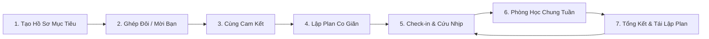

<<<<<<< HEAD
# PeerBridge

> Sinh viên khó tìm bạn học phù hợp và dễ lỡ nhịp khi lịch thay đổi → PeerBridge ghép bạn đồng hành và dùng AI để chia kế hoạch, điều phối phiên học, hỗ trợ học tiếp theo tiến độ.

**Đề EDU-07 · Nhóm P-005 · AI20K Build Phase Cohort 4**


## Vấn đề (Problem)

- **Ai gặp vấn đề?** Sinh viên tự học một mục tiêu có thời hạn, muốn học cùng người khác nhưng khó tìm người hợp mục tiêu, phong cách và nhịp học.
- **Tốn bao nhiêu thời gian hoặc tiền?** Nhóm chưa đo được con số đáng tin cậy. [Đặc tả sản phẩm](Product/PEERBRIDGE_PRODUCT_SPEC.md) dựa trên một số phỏng vấn ngắn; [báo cáo đánh giá](eval/results/report.md) ghi rõ chưa có đủ phản hồi người dùng thật để lượng hóa tác động.
- **Vì sao cách hiện tại chưa đủ?** Đây là giả thuyết sản phẩm: chat giúp trao đổi, lịch giúp nhớ giờ và AI có thể trả lời kiến thức, nhưng người học vẫn phải tự nối việc tìm bạn, chia mục tiêu, theo dõi tiến độ và điều chỉnh khi lỡ kế hoạch. PeerBridge đặt các bước này trong cùng một luồng học có sự đồng thuận của hai người.

## Giải pháp (Solution)

1. **Tìm bạn học:** người dùng mời bạn quen bằng link hoặc xem gợi ý xếp hạng theo mục tiêu và phong cách học. Thẻ gợi ý giải thích điểm và kiểu ghép **Bù trừ, Cùng tiến, Kỷ luật**. Danh sách đầu tiên có 8–10 hồ sơ khi đủ người hợp lệ; pool nhỏ thì hiện số thực có, có thể mở rộng tối đa 20.
2. **Lập và điều chỉnh kế hoạch:** AI chia mục tiêu thành buổi và việc cụ thể; người học chốt lịch, chọn việc học chung, check-in bằng ảnh và xem nhật ký của hai bạn. Ảnh được lưu ngay, không cần AI Vision phân tích. Khi quá sức hoặc lỡ nhịp, Cú Bridge đề xuất bước ngắn hơn, giảm tải hoặc dời lịch; người học xác nhận trước khi đổi kế hoạch.
3. **Điều phối học chung:** hai người chốt giờ, mục tiêu và timeline, rồi trò chuyện trong phòng học. Cú Bridge theo dõi trạng thái buổi học, hỗ trợ người đến sau bắt nhịp và, khi được bấm **Gợi ý**, đưa câu hỏi dựa trên nội dung hai người vừa trao đổi. Cuối buổi, hai bạn được mời lưu ảnh check-in vào nhật ký chung. Cú không làm bài thay người học.

AI viết gợi ý trong phạm vi luật của hệ thống; code kiểm tra điều kiện ghép, lịch, trạng thái buổi học và quyền xác nhận. Xem đặc tả [Matching](<Product/AI feature spec/FEATURE_SPEC_MATCHING.md>), [Planning](<Product/AI feature spec/FEATURE_SPEC_PLANNING.md>), [Tracking](<Product/AI feature spec/FEATURE_SPEC_TRACKING.md>) và [Điều phối phiên học](<Product/AI feature spec/FEATURE_SPEC_SESSION_FACILITATION.md>).

## Target User

- **Primary:** sinh viên có mục tiêu học tập rõ ràng, muốn tìm một bạn đồng hành và giữ nhịp theo kế hoạch cá nhân.
- **Secondary:** bạn học được mời vào cùng mục tiêu; người quản trị hoặc giảng viên xem các trường hợp cần kiểm duyệt trong phạm vi được cấp quyền.

## Tech Stack

| Layer | Technology |
|---|---|
| AI Agent | LangGraph cho plan coach và moderator; OpenAI hoặc provider được cấu hình, có luồng mẫu khi AI không khả dụng |
| Backend | FastAPI, Python 3.12, WebSocket |
| Frontend | Next.js 16, React 19, TypeScript |
| Database | SQLite, Alembic; chưa chuyển nghiệp vụ hiện tại sang PostgreSQL |
| DevOps | GitHub Actions, Dockerfile cho Render; backend trên Render, frontend trên Vercel |

[Sơ đồ kiến trúc](docs/architecture_diagram.md) · [Kiến trúc chi tiết](docs/architecture.md) · [Bản đồ code hiện tại](docs/PROJECT_LOGIC_MAP.md)

## Quick Start

Yêu cầu **Python 3.12**, **Node.js 22** và npm. Các lệnh dưới đây dành cho PowerShell trên Windows; chạy backend và frontend ở hai terminal. Không cần API key để xem luồng cơ bản; tính năng gọi AI thật cần cấu hình khóa và ngân sách trong `backend/.env`.

```powershell
# 1. Lấy mã nguồn
git clone https://github.com/AI20K-Build-Phase-Cohort-4/P-005.git
cd P-005

# 2. Backend — terminal thứ nhất
cd backend
py -3.12 -m venv .venv
.\.venv\Scripts\Activate.ps1
python -m pip install -r requirements.txt
Copy-Item .env.example .env
# Điền JWT_SECRET bằng một chuỗi bí mật riêng trong backend/.env
$env:APP_PORT = "8001"
python run.py
```

```powershell
# 3. Frontend — terminal thứ hai, từ thư mục P-005
cd frontend
npm ci
Copy-Item .env.example .env.local
npm run dev
```

Mở **http://localhost:3000**. API chạy ở **http://127.0.0.1:8001**; tài liệu API ở `/docs`. Biến `NEXT_PUBLIC_API_URL` trong `frontend/.env.local` cần trỏ đúng cổng backend. Xem [hướng dẫn local](Product/LOCAL_DEV_GUIDE.md) để cấu hình AI và xử lý lỗi môi trường. Không đưa `.env`, khóa API hoặc dữ liệu người dùng vào Git.

## Project Structure

```text
├── backend/
│   ├── app/
│   │   ├── agents/             # LangGraph plan coach và moderator
│   │   ├── routers/            # HTTP API
│   │   ├── matching/           # Chuẩn hóa và ghép cặp
│   │   ├── checkin/            # Check-in ảnh, nhật ký chung và dữ liệu cũ
│   │   ├── services/           # Nghiệp vụ kế hoạch, kết nối, coach
│   │   ├── study_meetings.py   # Buổi học chung và Cú Bridge
│   │   └── main.py             # Điểm khởi động FastAPI
│   ├── alembic/                # Thay đổi schema
│   ├── tests/                  # Kiểm tra backend
│   ├── .env.example
│   ├── Dockerfile.render
│   └── requirements.txt
├── frontend/
│   ├── app/                    # Trang và khung ứng dụng Next.js
│   ├── features/               # UI theo tính năng
│   ├── components/             # Thành phần dùng chung
│   ├── lib/                    # API client và kiểu dữ liệu
│   └── .env.example
├── docs/                       # Kiến trúc, triển khai, báo cáo
├── eval/                       # Dữ liệu và kết quả đánh giá
├── presentation/               # Pitch deck và tài liệu demo
├── .github/workflows/          # CI và quy trình triển khai
├── JOURNAL.md
├── WORKLOG.md
└── render.yaml
```

`Dockerfile` và `docker-compose.yml` ở **gốc repo** vẫn là bộ khung `src.main` của template, không khởi chạy ứng dụng PeerBridge trong `backend/app`. Dùng Quick Start ở trên hoặc [hướng dẫn deploy](docs/DEPLOY.md).

## API Endpoints

| Method | Path | Description |
|---|---|---|
| GET | `/health` | Kiểm tra API |
| POST | `/api/v1/auth/register` | Đăng ký tài khoản |
| POST | `/api/v1/matches/search` | Lấy gợi ý bạn học |
| POST | `/api/v1/plans/generate-personal` | Tạo kế hoạch cá nhân |
| POST | `/api/v1/plans/{pair_id}/replan` | Đề xuất điều chỉnh kế hoạch |
| POST | `/api/v1/checkins` | Lưu ảnh check-in, có thể gắn với việc đã học |
| POST | `/api/v1/study-meetings/{meeting_id}/join` | Vào buổi học |
| POST | `/api/v1/study-meetings/{meeting_id}/facilitator-questions` | Nhờ Cú gợi ý câu hỏi từ cuộc trò chuyện |
| GET | `/api/v1/coach/cases` | Lấy tình huống tiến độ cần hỗ trợ |

Danh sách API đầy đủ tại `http://127.0.0.1:8001/docs` sau khi chạy backend.

## Deliverables Checklist

- [x] Source code: [GitHub P-005](https://github.com/AI20K-Build-Phase-Cohort-4/P-005)
- [x] README.md
- [x] [Architecture Diagram](docs/architecture_diagram.md)
- [ ] AI Logs: có cơ chế ghi log; nhóm cần xác nhận log đã gửi lên hệ thống chương trình
- [x] [Live URL bản demo](https://peerbridge-deploy.vercel.app) — chạy từ repo deploy riêng, có thể chưa cùng commit với `main`
- [ ] Video demo: có [kịch bản](docs/video-demo.md), chưa có URL video trong repo
- [x] [Pitch Deck](presentation/pitch_deck.pptx)
- [x] [Weekly Journal](JOURNAL.md)
- [x] [Worklog](WORKLOG.md)
- [x] [Evaluation Evidence](eval/results/report.md) — có kết quả kỹ thuật; đánh giá người dùng thật và ảnh Vision thật còn thiếu

## Team

| Member | Role | Student ID |
|---|---|---|
| Chính | Onboarding, matching, đo tiến độ | Chưa cập nhật |
| Sang | Kế hoạch học, coach | Chưa cập nhật |
| Tú | AI Vision, moderator, tích hợp và deploy | Chưa cập nhật |
| Hiệp | UX/UI và phần nền | Chưa cập nhật |

Vai trò là phạm vi phụ trách ghi trong [TEAM_WORKFLOW.md](TEAM_WORKFLOW.md); nhóm cần xác nhận người trực tiếp làm từng phần, họ tên đầy đủ và mã sinh viên trước khi nộp.

## License

[MIT](LICENSE).
=======
# 🌉 PeerBridge AI — Nền Tảng Học Đôi & Giữ Nhịp Cam Kết Thông Minh

> **Một mục tiêu học tập · Một người bạn đồng hành · Một kế hoạch co giãn không bỏ cuộc.**  
> Giải quyết triệt để vấn đề vỡ kế hoạch khi tự học một mình, nỗi sợ bị phán xét và ma sát khi tìm bạn học của sinh viên.

---

## 📌 Mục lục

- [1. Vấn đề & Bối cảnh (Problem & Pain Points)](#1-vấn-đề--bối-cảnh-problem--pain-points)
- [2. Triết lý Thiết kế (Core Philosophy: Code vs. AI)](#2-triết-lý-thiết-kế-core-philosophy-code-vs-ai)
- [3. Luồng Trải nghiệm Người dùng (User Journey)](#3-luồng-trải-nghiệm-người-dùng-user-journey)
- [4. Hệ thống Tính năng Cốt lõi (Core Features)](#4-hệ-thống-tính-năng-cốt-lõi-core-features)
  - [4.1. Ghép cặp Thác nước Phân tầng (Waterfall Matching Hierarchy v2.1)](#41-ghép-cặp-thác-nước-phân-tầng-waterfall-matching-hierarchy-v21)
  - [4.2. Kế hoạch Học tập Co giãn 3 Tầng (Adaptive Planning)](#42-kế-hoạch-học-tập-co-giãn-3-tầng-adaptive-planning)
  - [4.3. Theo dõi Tiến độ & Thẻ Cứu Nhịp Duy Nhất (Unified Pacing Recovery)](#43-theo-dõi-tiến-độ--thẻ-cứu-nhịp-duy-nhất-unified-pacing-recovery)
  - [4.4. Phòng Học Chung 3 Giai đoạn (3-Phase Socratic Study Room)](#44-phòng-học-chung-3-giai-đoạn-3-phase-socratic-study-room)
  - [4.5. Kiểm duyệt & Hướng dẫn Socratic (AI Moderator & Guardrails)](#45-kiểm-duyệt--hướng-dẫn-socratic-ai-moderator--guardrails)
- [5. Kiến trúc Công nghệ (Tech Stack & Architecture)](#5-kiến-trúc-công-nghệ-tech-stack--architecture)
- [6. Hướng dẫn Khởi chạy Cục bộ (Local Development Setup)](#6-hướng-dẫn-khởi-chạy-cục-bộ-local-development-setup)
- [7. Kiểm thử Tự động (Automated Testing)](#7-kiểm-thử-tự-động-automated-testing)
- [8. Cấu trúc Dự án (Project Structure)](#8-cấu-trúc-dự-án-project-structure)
- [9. AI Usage Logging (Tiêu chuẩn AI20K)](#9-ai-usage-logging-tiêu-chuẩn-ai20k)

---

## 1. Vấn đề & Bối cảnh (Problem & Pain Points)

Sinh viên biết học nhóm có lợi, nhưng việc duy trì cam kết học tập độc lập thường đối mặt với các rào cản tâm lý và thực tế cuộc sống:

| # | Pain Point | Biểu hiện thực tế | Giải pháp của PeerBridge AI |
| :--- | :--- | :--- | :--- |
| **P1** | **Ngại chủ động tìm bạn học** | Tìm bạn cùng môn tốn công, rủ 1–2 người quen bị từ chối $\rightarrow$ nản lòng và học một mình. | **2 luồng linh hoạt**: Mời bạn quen bằng link hoặc gợi ý ứng viên thông minh qua thuật toán **Thác nước Hạ cấp Ưu tiên (Waterfall Matching)**. |
| **P2** | **Kế hoạch vỡ khi lịch trường chen vào** | Lên lịch dày theo cảm tính (*Planning Fallacy*). Khi thi cử/lịch trường đột xuất $\rightarrow$ lỡ 1–2 buổi $\rightarrow$ dồn việc $\rightarrow$ tội lỗi, sợ bạn học phán xét $\rightarrow$ ghosting và bỏ app (*What-the-hell effect*). | **Kế hoạch co giãn 3 tầng** (Tối thiểu 15p - Mục tiêu - Nâng cao) kèm **Ngày đệm an toàn** (20–30%) và **Thẻ Cứu Nhịp 1 chạm** (không phán xét, không phạt). |
| **P3** | **Quá tải kiến thức, thiếu trọng tâm** | AI truyền thống giải đáp mọi thứ nhưng không giúp người học biết phần nào là cốt lõi cần ưu tiên. | AI Planner tự động **phân loại ưu tiên**: Bắt buộc, Nên có, Bỏ có chủ đích (cho ca nước rút); điều chỉnh theo nền tảng người học. |
| **P4** | **Ảo tưởng thấu hiểu (Illusion of Explanatory Depth)** | Trao đổi xong tưởng mình hiểu nhưng thực tế hiểu sai, học vẹt. | **Phòng học chung 3 giai đoạn**: Sinh viên tự diễn giải lại kiến thức (Feynman technique); trả lời câu kiểm độc lập trước và sau buổi. |

---

## 2. Triết lý Thiết kế (Core Philosophy: Code vs. AI)

Sản phẩm kiên định nguyên tắc **phân định ranh giới chặt chẽ** giữa Code định lượng và Trí tuệ nhân tạo:

```
┌──────────────────────────────────────┐       ┌──────────────────────────────────────┐
│          CODE (DETERMINISTIC)        │       │             AI (PROBABILISTIC)       │
├──────────────────────────────────────┤       ├──────────────────────────────────────┤
│ • Tính toán định lượng & ngưỡng logic│       │ • Trích xuất ngữ nghĩa phong cách học│
│ • Kiểm soát đệm thời gian (20–30%)   │       │ • Chia nhỏ việc học theo 3 mức độ    │
│ • Quyết định THỜI ĐIỂM can thiệp     │       │ • Viết lời nhắn thấu cảm, không phạt │
│ • Lọc hard filters & phân bậc tier   │       │ • Đặt câu hỏi gợi mở Socratic        │
└──────────────────────────────────────┘       └──────────────────────────────────────┘
                                  ▲                 ▲
                                  └────────┬────────┘
                                           │
                           ┌───────────────────────────────┐
                           │   QUYỀN KIỂM SOÁT NGƯỜI DÙNG  │
                           │   (Human-in-the-Loop 1 Chạm)  │
                           └───────────────────────────────┘
```

1. **AI không phán xét, không so sánh**: Không hiển thị ai giỏi hơn ai, không trừ điểm uy tín công khai, không tạo áp lực tiêu cực.
2. **AI không làm hộ**: AI đóng vai trò người điều phối ở nền, **không giải thích thay sinh viên**. Giá trị cốt lõi nằm ở tương tác thật giữa 2 người bạn.
3. **Quyền kiểm soát thuộc về người học**: Mọi thay đổi kế hoạch do AI đề xuất đều cần xác nhận **1 chạm** từ người dùng.

---

## 3. Luồng Trải nghiệm Người dùng (User Journey)

Hành trình học tập 7 bước khép kín và tự phục hồi:



- **Mỗi người 1 mục tiêu active**: Tập trung tối đa năng lượng cho 1 mục tiêu trong một khoảng thời gian.
- **Tối đa 2 cặp bạn học đồng thời**: Tránh quá tải nhận thức và duy trì cam kết sâu sắc.

---

## 4. Hệ thống Tính năng Cốt lõi (Core Features)

### 4.1. Ghép cặp Thác nước Phân tầng (Waterfall Matching Hierarchy v2.1)
Khắc phục bài toán pool pilot nhỏ (~30–50 người) dễ dẫn tới >80% Zero-match bằng cơ chế tự động hạ cấp ưu tiên:

```
[Bậc 1: Golden Match] ──(Không có)──> [Bậc 2: Peer Match] ──(Không có)──> [Bậc 3: Body Double] ──(Không có)──> [Bậc 4: Queue]
  (Bù trừ 2 chiều)                     (Cùng học 1 môn + Hợp gu)          (Khác môn + Cùng deadline)          (Chờ pool mới)
```

| Bậc | Phân loại | Điều kiện Logic | Trọng số Thuật toán | Badge Giao diện |
| :---: | :--- | :--- | :--- | :--- |
| **Bậc 1** | **Bù trừ 2 chiều** *(Golden Match)* | A cần X dạy Y ↔ B cần Y dạy X *(Skill-swap)* | Concept: 35%<br>Style: 45%<br>Goal: 20% | 🌟 **Cặp đôi bù trừ hoàn hảo**<br>*(A chỉ B môn X, B hỗ trợ A môn Y)* |
| **Bậc 2** | **Cùng tiến** *(Peer Match)* | Cùng học chung môn X + Phong cách hợp | Concept: 25%<br>**Style: 50%**<br>Goal: 25% | 🤝 **Cùng cày một môn**<br>*(Cùng ôn môn X và cùng nhịp học)* |
| **Bậc 3** | **Đồng hành kỷ luật** *(Body Double)* | Khác môn hoàn toàn + Cùng mức độ gấp (Deadline) | Concept: 0%<br>**Style: 60%**<br>Goal: 40% | ⚡ **Đồng đội giữ kỷ luật**<br>*(Cùng chạy deadline gấp, điểm danh chéo)* |
| **Bậc 4** | **Hàng đợi** *(Queue)* | Điểm tổng hợp $< 0.50$ | — | Bổ sung đủ pool 5 người kèm nhãn `⚠️ [Chưa chắc]` |

- **StyleScore 5 chiều đặc điểm**: Vai trò khi học (Giải thích/Nghe/Cân bằng), Nhịp học (Dồn đập/Đều đặn), Phong cách phản hồi (Tranh luận/Tự làm/Linh hoạt), Môi trường học (Im lặng/Trao đổi), Khi gặp khó (Tự research/Hỏi ngay/Linh hoạt). Chuẩn hóa theo độ tin cậy (*Confidence*), không trừ điểm khi văn bản ngắn.
- **GoalScore & TimeframeMatch**: Phân loại mức độ gấp (`gap` $\le 14$ ngày, `vua` 15–45 ngày, `dai` $> 45$ ngày).
- **Bộ lọc Toggle "Ưu tiên cùng trường"**: Đưa ứng viên cùng trường lên đầu danh sách trực quan mà không lọc rỗng pool.
- **Thưởng duy trì (Bonus Drop)**: Cộng $+0.05$ điểm ưu tiên cho người duy trì $\ge 30\%$ thời gian mục tiêu trước khi hoàn thành.

---

### 4.2. Kế hoạch Học tập Co giãn 3 Tầng (Adaptive Planning)
- **Cấu trúc việc học 3 mức độ**:
  1. **Tối thiểu** (10–15 phút): Kích hoạt khi quá bận/mệt. Hoàn thành mức này vẫn được tính là 1 ngày giữ nhịp thành công.
  2. **Mục tiêu**: Khối lượng chuẩn theo ngày (30–90 phút).
  3. **Nâng cao**: Mở rộng bài tập/kiến thức sâu khi sung sức.
- **Định dạng triển khai rõ ràng**: Viết theo công thức *"Nếu [Thời gian & Địa điểm] thì [Hành động cụ thể]"* (ví dụ: *"Nếu 19h thứ Ba tại thư viện thì làm 5 bài JOIN"*).
- **Xếp lịch thông minh**: Code tính toán tự động chừa sẵn **20%–30% đệm an toàn** và **1 ngày dự phòng mỗi tuần**.
- **3 loại Plan theo mốc thời gian**:
  - **Gấp** ($< 14$ ngày): Cắt bỏ râu ria, chỉ tập trung dạng bài cốt lõi, không tăng dần khối lượng.
  - **Vừa** ($14 - 60$ ngày): Tăng dần tải, 1 ngày dự phòng/tuần.
  - **Dài** ($> 60$ ngày): Xác định cột mốc lớn, rà soát lại sau mỗi 2–4 tuần.

---

### 4.3. Theo dõi Tiến độ & Thẻ Cứu Nhịp Duy Nhất (Unified Pacing Recovery)
- **Chỉ số Pacing định lượng**:
  $$\text{Pacing} = \frac{\text{Tổng giờ ước lượng của việc đã xong}}{\text{Tổng giờ ước lượng của việc đáng lẽ phải xong đến hôm nay}}$$
  - $\text{Pacing} \ge 1.0$: Đúng hoặc vượt tiến độ.
  - $\text{Pacing} < 0.7$: Trễ nhịp đáng kể $\rightarrow$ Kích hoạt hỗ trợ.
- **Thẻ Cứu Nhịp Duy Nhất (The Unified Pacing Card)**: Toàn bộ tình huống lỡ bài, bận đột xuất đều được quy về **1 Thẻ Card duy nhất** ở đầu màn hình với thao tác **$\le 3$ giây (1 chạm)**:
  - `[⚡ Cày bản 15 phút]` (Hoàn thành mức tối thiểu)
  - `[📅 Dời sang ngày đệm]` (Dời việc vào ngày dự phòng trong tuần)
  - `[🗑️ Bỏ có chủ đích]` (Chuyển việc không cốt lõi vào danh sách "Để sau", xóa bỏ cảm giác nợ bài)
- **AI Coach Nhân văn**:
  - Tần suất: Tối đa 1 tin nhắn/người/ngày.
  - Giờ giới nghiêm (Blackout hours): Tuyệt đối không gửi từ **22:00 đến 07:00**.
  - Không đổ lỗi, không gửi tin nhắn phán xét hay so sánh hai người học.

---

### 4.4. Phòng Học Chung 3 Giai đoạn (3-Phase Socratic Study Room)
Tần suất 1 buổi/tuần (25, 50 hoặc 75 phút) qua phòng học tương tác thời gian thực:

1. **Trước buổi (~2 phút)**: Đặt mục tiêu buổi trong 1 câu, phân chia vai ai giải thích phần nào. AI tạo 2–3 câu kiểm tra chẩn đoán.
2. **Trong buổi**: Sinh viên tự diễn giải lại kiến thức bằng lời của mình (Feynman). Hai người trả lời độc lập, thảo luận, rồi trả lời lại. AI Moderator chạy ngầm bấm giờ, gợi ý câu hỏi mở Socratic, **không giải thích thay**.
3. **Sau buổi (~3 phút)**: Trả lời câu kiểm độc lập một mình. AI tổng kết: Đã nắm vững phần nào, phần nào chưa chắc tự động nạp vào plan tuần sau.

---

### 4.5. Kiểm duyệt & Hướng dẫn Socratic (AI Moderator & Guardrails)
- **LangGraph StateGraph Pipeline**: Phân tích tin nhắn theo thời gian thực qua WebSocket.
- **5 Cấp độ Quyết định (Decision Tiers)**:
  - `ALLOW`: Tin nhắn thảo luận bình thường, chuyển tiếp ngay lập tức.
  - `GUIDE`: Người học hỏi xin đáp án trực tiếp $\rightarrow$ AI can thiệp với câu hỏi gợi mở Socratic.
  - `WARN`: Cảnh báo vi phạm văn hóa giao tiếp nhẹ.
  - `BLOCK`: Chặn hoàn toàn tin nhắn xúc phạm, độc hại, quấy rối.
  - `ESCALATE`: Chuyển vụ việc cho Quản trị viên/Giảng viên khi cần can thiệp.
- **Output Guard**: Kiểm duyệt phản hồi của AI trước khi trả về cho sinh viên để đảm bảo an toàn và tính sư phạm.

---

## 5. Kiến trúc Công nghệ (Tech Stack & Architecture)

```
┌────────────────────────────────────────────────────────────────────────┐
│                        FRONTEND (Next.js 16 / React 19)                │
│  • App Router, TypeScript, Tailwind-free Vanilla CSS Design Tokens     │
│  • Feature-based Modular Architecture (peer-connections, plan, etc.)  │
└───────────────────────────────────┬────────────────────────────────────┘
                                    │ REST API / WebSocket
┌───────────────────────────────────▼────────────────────────────────────┐
│                        BACKEND (FastAPI / Python 3.11)                 │
│  • App Lifecycle, Dependency Injection, Pydantic v2 Schemas            │
│  • SQLite Storage (Transactional, foreign keys enabled)                │
│  • Matching Engine (Waterfall Hierarchy, 5-Dimension Style Extraction) │
│  • Plan Coach & Study Session Engine                                  │
│  • LangGraph Socratic AI Moderator & WebSocket Connection Manager      │
│  • Embedding E5 / Qdrant Vector Store (RAG-ready Pipeline)             │
└───────────────────────────────────┬────────────────────────────────────┘
                                    │ LLM API
┌───────────────────────────────────▼────────────────────────────────────┐
│                    AI PROVIDERS (OpenAI-compatible)                    │
│  • gpt-4o-mini / Local LLM / Deterministic Fake Fallback Modes         │
└────────────────────────────────────────────────────────────────────────┘
```

---

## 6. Hướng dẫn Khởi chạy Cục bộ (Local Development Setup)

### 📌 Cổng Mạng (Ports) Chuẩn Hóa
- **Backend (FastAPI)**: `http://127.0.0.1:8001` *(Tránh xung đột cổng 8000 trên Windows)*
- **Frontend (Next.js)**: `http://localhost:3000`
- **Tài liệu API (Swagger UI)**: `http://127.0.0.1:8001/docs`

---

### 🚀 Bước 1: Khởi động Backend (FastAPI)

Mở **Terminal 1** tại thư mục gốc dự án:

```powershell
# 1. Di chuyển vào thư mục backend
cd backend

# 2. Kích hoạt môi trường ảo Python
.\.venv\Scripts\Activate.ps1

# 3. Cài đặt dependencies (nếu chưa có)
python -m pip install -r requirements.txt

# 4. Sao chép file môi trường (nếu chưa có)
if (-not (Test-Path .env)) { Copy-Item .env.example .env }

# 5. Khởi động server backend (chạy cổng 8001)
python run.py
```

*Server sẽ tự động tạo cơ sở dữ liệu SQLite tại `backend/data/dongdieu.db` và nạp dữ liệu mẫu.*

---

### 💻 Bước 2: Khởi động Frontend (Next.js)

Mở **Terminal 2** tại thư mục gốc dự án:

```powershell
# 1. Di chuyển vào thư mục frontend
cd frontend

# 2. Cài đặt dependencies (nếu chưa có)
npm install

# 3. Cấu hình biến môi trường kết nối backend
if (-not (Test-Path .env.local)) {
    Set-Content -Encoding UTF8 .env.local "NEXT_PUBLIC_API_URL=http://localhost:8001"
}

# 4. Khởi chạy dev server (dùng webpack tránh lỗi symlink Windows)
npm run dev
```

Mở trình duyệt truy cập: **[http://localhost:3000](http://localhost:3000)**.

---

## 7. Kiểm thử Tự động (Automated Testing)

Toàn bộ hệ thống được bảo vệ bởi bộ kiểm thử tự động toàn diện:

### Kiểm thử Backend (Pytest)
```powershell
cd backend
.\.venv\Scripts\python.exe -m pytest tests/test_matching_engine.py tests/test_waterfall_matching.py tests/test_matches_api.py -v
```
*(Kết quả: **15/15 tests PASS** bao gồm 4 bậc Waterfall, 5 chiều phong cách, hạn chót và API ghép cặp).*

### Kiểm thử Frontend (Node Test Runner & Component Tests)
```powershell
cd frontend
node --test tests/person1/peer-ui.test.cjs
```
*(Kết quả: **22/22 tests PASS** kiểm tra giao diện, xử lý trạng thái lời mời, kết nối).*

---

## 8. Cấu trúc Dự án (Project Structure)

```text
P-005/
├── backend/
│   ├── app/
│   │   ├── api/v1/          # REST endpoints (auth, profiles, matches, connections, plans, sessions)
│   │   ├── services/        # Logic nghiệp vụ (matching_engine, matching_config, matches, plans)
│   │   ├── agents/          # AI agents (plan_coach, moderation_agent, moderator_graph)
│   │   ├── repositories/    # Truy xuất dữ liệu SQLite
│   │   ├── schemas.py       # Pydantic data schemas
│   │   └── main.py          # FastAPI application entrypoint
│   ├── data/                # Database SQLite (dongdieu.db) & Uploads
│   ├── tests/               # Test suites backend (Pytest)
│   └── run.py               # Script khởi chạy Uvicorn cổng 8001
├── frontend/
│   ├── app/                 # Next.js App Router (page.tsx, layout.tsx, globals.css)
│   ├── components/          # Shared UI components (Avatar, Navbar, icons)
│   ├── features/            # Feature-sliced modules:
│   │   ├── peer-connections/ # Giao diện Ghép cặp Waterfall & Quản lý Kết nối
│   │   ├── study-plan/       # Giao diện Kế hoạch co giãn & Thẻ Cứu Nhịp
│   │   ├── study-sessions/   # Giao diện Phòng học chung Socratic
│   │   └── overview/         # Dashboard tổng quan tiến độ
│   ├── lib/                 # API client (api.ts) & TypeScript definitions (types.ts)
│   └── tests/               # Frontend component & UI tests
├── Product/                 # Tài liệu đặc tả sản phẩm & AI Specs (v2.1)
│   ├── AI feature spec/     # Specs chi tiết (MATCHING, PLANNING, TRACKING, TECH_NOTE)
│   ├── LOCAL_DEV_GUIDE.md   # Hướng dẫn chạy local
│   └── PEERBRIDGE_PRODUCT_SPEC.md # Đặc tả sản phẩm tổng quan
└── README.md                # Tài liệu dự án
```

---

## 9. AI Usage Logging (Tiêu chuẩn AI20K)

Dự án tích hợp cơ chế ghi nhận prompt và hoạt động AI theo tiêu chuẩn AI20K:

```powershell
# Cài đặt git hooks ghi log một lần:
powershell -ExecutionPolicy Bypass -File scripts\setup_hooks.ps1

# Đồng bộ log thủ công lên server giám sát:
.\submit_log.cmd
# hoặc từ frontend:
npm run log
```

Log hội thoại với AI được ghi tự động vào `.ai-log/session.jsonl` và đồng bộ an toàn qua pre-push hook.

---

*© 2026 PeerBridge AI Team · Phát triển vì một cộng đồng sinh viên học tập bền bỉ.*
>>>>>>> 29066618049be865e9daa585fed068c149bc780f
