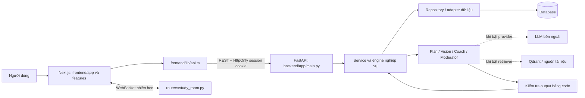
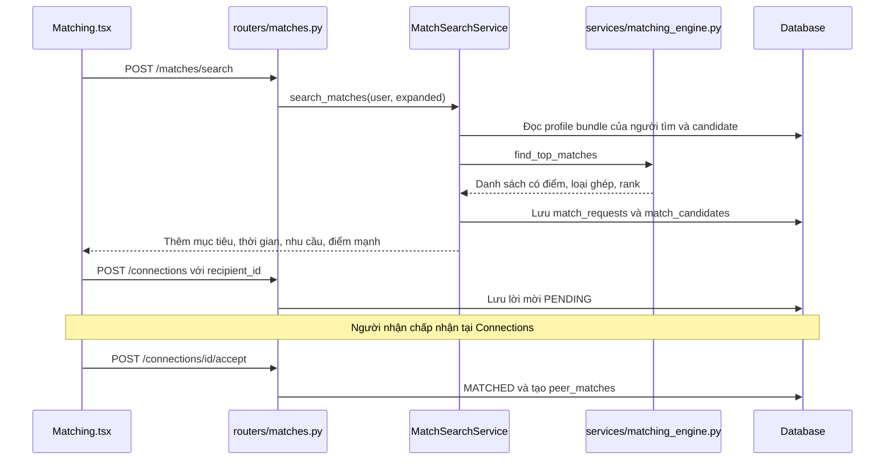
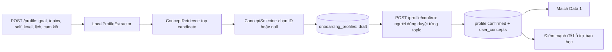
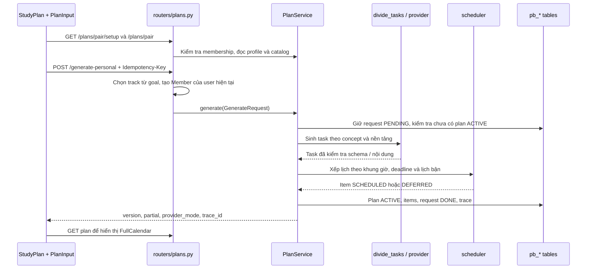
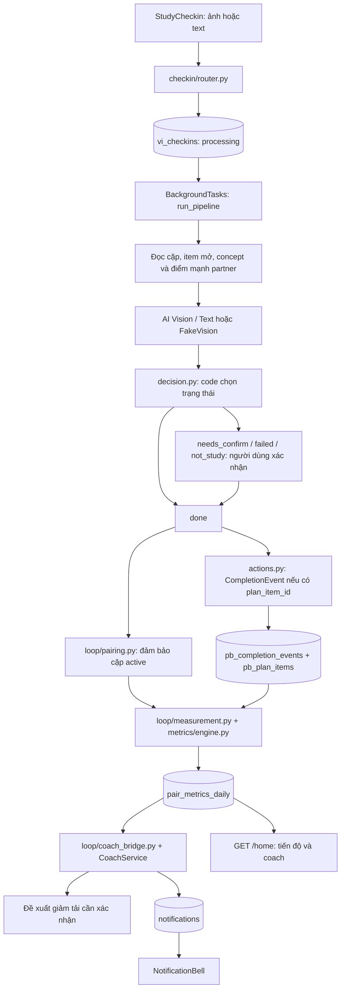

# Bản đồ logic hiện tại của PeerBridge

Ngày đối chiếu: **14/10/2026**. Phạm vi: code trong `frontend/` và `backend/app/`, sau khi frontend được tổ chức theo tính năng.

Tài liệu mô tả đường gọi có trong code, không khẳng định môi trường đang bật provider AI nào. Không đọc API key, không chạy LLM, không sửa nghiệp vụ để lập tài liệu này. Các nhận xét về lỗi tích hợp bên dưới là phân tích tĩnh, cần xác nhận bằng kịch bản chạy thực tế.

Mục lục:

- [Phân chia code](#1-cách-đọc-hệ-thống)
- [Điểm nối FE–BE–AI](#2-các-điểm-febeai-nối-với-nhau)
- [Match](#3-luồng-match-hiện-tại)
- [Concept](#4-luồng-concept-chuẩn-hóa-kiến-thức-và-mức-tự-khai-báo)
- [Plan](#5-luồng-plan-tạo-kế-hoạch-cá-nhân-trong-một-cặp)
- [Tracking và Coach](#6-luồng-tracking-check-in--hoàn-thành--metrics--coach)
- [Dữ liệu và ID](#7-dữ-liệu-và-identity-nối-các-tính-năng)
- [Các điểm cần kiểm soát](#8-những-điểm-cần-kiểm-soát-trước-khi-mở-rộng)
- [Cấu hình và quan sát](#9-cấu-hình-và-dấu-hiệu-quan-sát)
- [Bảng vị trí sửa logic](#10-muốn-đổi-logic-thì-bắt-đầu-ở-đâu)

## 1. Cách đọc hệ thống

**FE nhận thao tác và hiển thị kết quả. BE kiểm tra quyền, dữ liệu và trạng thái. AI là một nhóm module bên trong BE, được gọi khi cần phân tích hoặc sinh nội dung.** Hiện không có một server AI riêng mà FE gọi trực tiếp.

### Phân chia code

| Khu vực | Đường dẫn | Trách nhiệm |
| --- | --- | --- |
| Khung FE | [frontend/app/page.tsx](../frontend/app/page.tsx), [layout.tsx](../frontend/app/layout.tsx) | Đăng nhập, điều hướng, hồ sơ, mount màn hình theo role và trang |
| Tính năng FE | [frontend/features/](../frontend/features/) | `peer-connections`, `study-plan`, `study-sessions`, `checkin`, `overview`, `notifications`, `landing`, `moderation` |
| UI dùng chung | [frontend/components/](../frontend/components/) | `ui/`: avatar, icon, input; `common/`: component được nhiều tính năng dùng |
| Contract và API FE | [frontend/lib/](../frontend/lib/) | HTTP client, type dữ liệu, ngày giờ; `types/index.ts` tổng hợp type |
| Điểm khởi động BE | [backend/app/main.py](../backend/app/main.py) | Mount router, middleware, khởi tạo DB/seed, dependency override và vòng chạy định kỳ |
| HTTP/WebSocket | [backend/app/routers/](../backend/app/routers/) và router trong các module | Kiểm tra đầu vào, xác thực, gọi service, chuyển lỗi thành response |
| Nghiệp vụ BE | [backend/app/services/](../backend/app/services/) | Matching UI, kết nối, kế hoạch, coach, phiên học, kiểm duyệt |
| Nghiệp vụ Data 1 | [onboarding/](../backend/app/onboarding/), [matching/](../backend/app/matching/), [metrics/](../backend/app/metrics/) | Chuẩn hóa concept, ghép cặp theo concept, đo tiến độ |
| AI Plan/Coach | [agents/plan_coach/](../backend/app/agents/plan_coach/) | Chia việc, scheduler, kiểm tra kế hoạch, lựa chọn lời nhắc, trace/eval |
| AI Vision | [checkin/](../backend/app/checkin/) | Đọc ảnh/nội dung check-in, đề xuất việc liên quan, quyết định có cần người dùng xác nhận |
| AI phòng học | [agents/moderator/](../backend/app/agents/moderator/) | Phân loại ý định, đánh giá rủi ro, hướng dẫn có tài liệu và chuyển giảng viên duyệt |
| Lưu trữ BE | [repositories/](../backend/app/repositories/), repository/models/schema của từng module | Đọc/ghi dữ liệu; không phải phần render UI hoặc prompt |
| Nối các nhóm | [backend/app/loop/](../backend/app/loop/) | Nối pair, Plan, check-in, metrics, coach và thông báo |
| Bản cũ FE | [frontend/legacy/](../frontend/legacy/) | Đối chiếu lịch sử; không được app hiện tại import |

### Ranh giới AI và code

| Chức năng | AI làm gì? | Code quyết định gì? |
| --- | --- | --- |
| Match trên UI hiện tại | Không gọi LLM trong đường `/matches/search` | Lọc hồ sơ, tính điểm, phân loại, xếp hạng |
| Concept onboarding | Mặc định rule/alias; có cổng gắn selector LLM | Concept hợp lệ, confidence, bản draft, xác nhận của người dùng |
| Match Data 1 | Có thể rerank nếu bật | Candidate hợp lệ, quyền, ngưỡng ghép, hàng đợi, transaction tạo pair |
| Plan | Chia nội dung thành task, đầu ra mong đợi | Concept/prerequisite, giờ học, deadline, giới hạn phút, phiên bản, lưu kế hoạch |
| Vision | Nhận diện việc học và concept, gợi ý item, viết tóm tắt | Quyền truy cập, ngưỡng confidence, trạng thái check-in, completion event |
| Metrics | Không cần LLM để tính số đo | Pacing, gap, streak, risk và thời điểm dữ liệu được biết |
| Coach | Khi bật, chọn trong action được phép và viết câu nhắc | Action nào được phép, giờ nghỉ, giới hạn ngày, tạo draft replan, quyền chấp nhận |

## 2. Các điểm FE–BE–AI nối với nhau

### FE gọi BE ở đâu?

[frontend/lib/api.ts](../frontend/lib/api.ts) là điểm gọi HTTP chính. `NEXT_PUBLIC_API_URL` mặc định trong code là `http://localhost:8001`. Phiên trình duyệt gửi cookie `HttpOnly` với `credentials: include`; Bearer token vẫn được hỗ trợ cho client cũ. Ảnh gửi bằng `FormData`. Lỗi `401` phát tín hiệu về FE để xử lý phiên đăng nhập.

BE mount phần lớn router dưới `/api/v1` tại [main.py](../backend/app/main.py). [security.py](../backend/app/security.py) xác định user và role; service/repository tiếp tục kiểm tra quyền trên pair, plan hoặc session. FE đổi tab/role không tự tạo quyền ở BE.

| Luồng | FE thực sự gọi | API chính | Điểm xử lý BE |
| --- | --- | --- | --- |
| Hồ sơ | `page.tsx` → `profile`, `updateProfile` | `GET/PUT /api/v1/profiles/me` | `routers/profiles.py`, `repositories/profiles.py` |
| Gợi ý match | `Matching.tsx` → `searchMatches` | `POST /api/v1/matches/search` | `routers/matches.py` → `services/matches.py` |
| Kết nối | `Matching.tsx`, `Connections.tsx` | `POST /api/v1/connections`, `POST /connections/{id}/accept` hoặc `/reject` | `services/connections.py` → `repositories/connections.py` |
| Setup và đọc Plan | `StudyPlan.tsx` | `GET /api/v1/plans/{pair_id}/setup`, `GET /plans/{pair_id}` | `services/plans.py` |
| Tạo Plan cá nhân | `PlanInput.tsx` → `generatePersonalPlan` | `POST /api/v1/plans/generate-personal` | `routers/plans.py` → `PlanService.generate` |
| Sửa lịch | `PlanCalendar.tsx` qua callback `StudyPlan.tsx` | `PATCH /api/v1/plans/{pair_id}/items/{item_id}/schedule` | `PlanService.edit_schedule` |
| Giảm tải / chấp nhận | `StudyPlan.tsx` | `POST /api/v1/plans/{pair_id}/replan`, `/proposals/{id}/accept` hoặc `/reject` | `PlanService.replan`, `decide_proposal` |
| Coach | Nút “Gợi ý cách giữ nhịp” | `POST /api/v1/coach/{pair_id}/evaluate` | `CoachService` được thay adapter trong `main.py` |
| Check-in | `StudyCheckin.tsx` | `POST /api/v1/checkins`, `/checkins/text`, `/checkins/{id}/confirm`; GET item để theo dõi xử lý | `checkin/router.py`, `service.py`, `pipeline.py` |
| Feed học cùng | `StudyCheckin.tsx` | `GET /api/v1/pairs/me/feed` | `checkin/service.py` |
| Tổng quan / thông báo | `ProductOverview.tsx`, `NotificationBell.tsx` | `GET /api/v1/home`, `/notifications` | `home/overview.py`, `home/notifications.py` |
| Phiên học | `ProductSessions.tsx`, `StudyRoom.tsx` | `/api/v1/sessions`; WebSocket `/ws/sessions/{id}` | `services/sessions.py`, `services/study_room.py` |

Các API concept `/concepts`, `/profile`, `/profile/confirm` và match Data 1 `/pairs/match` **đã được mount**, nhưng API client/màn hình FE hiện tại chưa gọi luồng onboarding concept đó. Tránh nhầm `/profile` với `/profiles/me`.

### Các adapter nối BE với AI

Trong [main.py](../backend/app/main.py), bốn dependency được thay:

| Dependency | Adapter thực sự được nối | Ý nghĩa |
| --- | --- | --- |
| `get_plan_service` | `loop/ai_clients.py:get_team_plan_service` | Chọn provider Plan và ghi chi phí; hết ngân sách có thể chuyển sang template |
| `get_reranker` | `loop/ai_clients.py:get_team_reranker` | Chỉ tác động match Data 1, không tác động match trên UI hiện tại |
| `get_measurement_source` | `loop/measurement.py:get_team_measurement_source` | Đọc Plan ACTIVE và check-in thực để tính metrics |
| `get_coach_service` | `loop/coach_bridge.py:get_team_coach_service` | Coach đọc metrics Data 1 và gửi thông báo trong app |

Các lời gọi trực tiếp `PlanService()` trong check-in/coach không tự đi qua dependency override của FastAPI. Khi đổi provider hoặc nguồn dữ liệu, cần kiểm tra cả dependency lẫn các chỗ tạo service trực tiếp.

## 3. Luồng Match hiện tại

### 3.1 Đường UI: gợi ý hồ sơ → lời mời → kết nối

Code chính: [Matching.tsx](../frontend/features/peer-connections/components/Matching.tsx), [MatchCandidateCard.tsx](../frontend/features/peer-connections/components/MatchCandidateCard.tsx), [services/matches.py](../backend/app/services/matches.py), [matching_engine.py](../backend/app/services/matching_engine.py), [matching_config.py](../backend/app/services/matching_config.py).

1. Hồ sơ gồm `profile`, `needs_help_with`, `can_help_with`, `availability`. Khi lưu, [matching_profile.py](../backend/app/services/matching_profile.py) tách “Muốn học X trong N tuần” thành `matching_goal.topic`, `duration_days`, `deadline_level`. Câu gốc vẫn ở `learning_goals`.
2. Repository đưa cả tài khoản STUDENT thật và hồ sơ mẫu vào gợi ý. Response có `is_seed`; FE hiển thị nhãn “Hồ sơ mẫu”. Theo yêu cầu demo, cả hai loại đều có thể nhận lời mời PENDING qua nút “Cùng học nhé”; không tự chấp nhận hồ sơ mẫu. Engine loại chính user và hồ sơ bị đánh dấu không phù hợp; lượt thường cần một tín hiệu liên quan về kỹ năng, nhu cầu, mục tiêu hoặc deadline gấp. Lượt mở rộng nới điều kiện liên quan, vẫn giữ các kiểm tra đầu vào đó.
3. Engine tính ba nhóm điểm: `concept_score` về nội dung cần/có thể hỗ trợ, `style_score` về năm lựa chọn cách học, `goal_score` về mục tiêu/thời gian. Tên `concept_score` ở đây không đồng nghĩa với việc đang đọc `user_concepts` của Data 1.
4. Ưu tiên loại ghép trước, rồi điểm trong từng loại. Do đó người có điểm cao hơn ở loại sau vẫn có thể đứng dưới người ở loại trước.

| Loại ở UI | Tier ở BE | Hỗ trợ học | Cách học | Mục tiêu/thời gian |
| --- | --- | ---: | ---: | ---: |
| 🌟 Bù trừ | `tier_1_golden` | 35% | 45% | 20% |
| 🤝 Cùng tiến | `tier_2_peer` | 25% | 50% | 25% |
| ⚡ Kỷ luật | `tier_3_discipline` | 0% | 60% | 40% |

BE còn có `tier_4_queue`; card FE hiện fallback sang nhãn Cùng tiến cho tier không thuộc Bù trừ/Kỷ luật. Đây là trường hợp cần quyết định cách hiển thị nếu danh sách mở rộng chứa queue.

Số gợi ý lượt đầu theo quy mô pool, tối đa 10 và cố gắng đạt 8 khi đủ hồ sơ. Lượt mở rộng tối đa 20. FE phân trang **3 hồ sơ/trang**, ưu tiên cùng trường bằng sắp xếp phía FE, và chỉ hiện nút mở rộng ở trang cuối.

Engine vẫn có `calculate_retention_bonus` cộng tối đa 5 điểm khi dữ liệu duy trì đủ điều kiện. Việc bỏ câu giải thích 5 điểm khỏi popup **chưa bỏ phép cộng này ở BE**. `friendlyScores` trong FE cũng đang khai báo lại các phần trăm của BE; đổi công thức cần cập nhật cả hai hoặc đưa công thức vào response.

File [services/match_ai.py](../backend/app/services/match_ai.py) có hàm rerank nhưng không được gọi từ đường `MatchSearchService` đang dùng. Không coi sự tồn tại của file đó là bằng chứng UI đang dùng AI rerank.

### 3.2 Đường Data 1: concept đã xác nhận → hàng đợi → pair

Đường riêng: `POST /api/v1/pairs/match` → [matching/service.py](../backend/app/matching/service.py) → `rank_candidates` → rerank tùy chọn → kiểm tra lại revision và candidate → ghép khi candidate cũng đang chờ và đạt ngưỡng; nếu chưa ghép thì giữ hàng đợi.

Đường này dùng `onboarding_profiles` đã confirmed và `user_concepts`, có cấu hình riêng tại [matching/config.py](../backend/app/matching/config.py): bù trừ 35%, concept chung 25%, thời gian 20%, cam kết 20%; xét tối đa 5 candidate. Các tỷ lệ này **không phải** công thức của card đang hiển thị.

[matching/repository.py](../backend/app/matching/repository.py) tạo hoặc tái sử dụng `peer_matches`, sau đó tạo `pairs` và `pair_memberships` cùng ID. Luồng này không phải đường bấm gửi lời mời PENDING trên màn Matching hiện tại.

## 4. Luồng Concept: chuẩn hóa kiến thức và mức tự khai báo

Concept là một đơn vị kiến thức có ID ổn định, tên, alias và prerequisite. Nó giúp nối nhu cầu học, kế hoạch và check-in mà không phải so sánh câu chữ tự do ở mọi bước.

Code: [onboarding/router.py](../backend/app/onboarding/router.py), [service.py](../backend/app/onboarding/service.py), [normalization.py](../backend/app/onboarding/normalization.py), [retrieval.py](../backend/app/onboarding/retrieval.py), [repository.py](../backend/app/onboarding/repository.py).

- Catalog Data 1 nằm ở [backend/data/concepts/catalog.json](../backend/data/concepts/catalog.json), được đọc qua `onboarding/catalog.py`; phiên bản `2026-10-14.3` có 129 nội dung thuộc 26 nhóm môn. SQL/Python giữ ID `sql.*` và `py.*`; các môn mới dùng tiền tố nhóm môn tương ứng. `learning_domains.py` khai báo nhóm môn dùng chung với Plan.
- Mặc định extractor, retriever và selector dùng local rules/alias. Selector yêu cầu độ tin cậy từ 0.75; kết quả mơ hồ có thể là `null`. Có `StructuredConceptSelector` để inject JSON client nhưng `get_onboarding_service` hiện chưa nối provider đó.
- `submit` lưu draft; `confirm` cần đúng revision, duyệt toàn bộ topic và ID hợp lệ mới lưu confirmed. Người dùng có thể sửa mapping.
- `user_concepts` giữ role `need/offer`, mức tự khai báo và `theta`. Giá trị khởi tạo theo `unknown=-1`, `learning=0`, `strong=1`; khi đã có attempts thì repository giữ giá trị cũ.
- Chưa thấy đường check-in/metrics tự tăng `theta` hoặc tạo bài đánh giá mastery. Check-in hoàn thành một việc không chứng minh người học đã thành thạo concept.

**Hiện FE lưu hồ sơ qua `/profiles/me`, chưa có bước gọi `/profile` và `/profile/confirm`.** Vì vậy hồ sơ hiển thị đầy đủ trên card không đảm bảo đã có concept profile confirmed để dùng `/pairs/match` hoặc lấy điểm mạnh từ `user_concepts`.

### Ý nghĩa trong sản phẩm và hướng UI

“Concept” là tên kỹ thuật nội bộ. Trên giao diện dùng **nội dung học**, **chủ đề cần hỗ trợ**, **phần đã biết** hoặc tên kỹ năng cụ thể; không bắt người dùng hiểu thuật ngữ hay chọn ID kỹ thuật từ một catalog dài.

Hướng mong muốn: người dùng nhập tự nhiên → hệ thống nhận diện kỹ năng → gom các cách gọi tương đương về cùng ID → giữ quan hệ giữa các kỹ năng liên quan nhưng khác nhau → chỉ hỏi lại bằng câu ngắn/tên dễ hiểu khi không chắc. Ví dụ “viết luận IELTS” và “IELTS Writing Task 2” có thể cùng nội dung; “IELTS Speaking” là nội dung liên quan trong cùng môn nhưng không được coi là cùng kỹ năng viết.

Code hiện chưa làm đầy đủ bước hiểu ngữ nghĩa này:

- `onboarding/retrieval.py` tra alias/từ khóa, `normalization.py` chọn ID theo ngưỡng; selector LLM là cổng tùy chọn chưa nối trong service mặc định.
- `_canonical_topic` của match UI gom IELTS, TOEIC và tiếng Anh về `english`, chưa phân biệt kỹ năng con.
- `goal_similarity` của match UI so tập từ chung, chưa dùng mapping nội dung chuẩn hóa để tính tương đồng mục tiêu.
- Form Plan có danh sách chọn nội dung/ID cũ nằm trong `frontend/legacy/components/StudyPlan.tsx`; form đang chạy là `features/study-plan/components/PlanInput.tsx`, nhận mục tiêu tự nhiên. Backend suy ra nhóm môn và tra alias trong catalog để chọn nội dung phù hợp; đây vẫn là quy tắc local, chưa phải mapper ngữ nghĩa bằng LLM.

Các thay đổi thuật ngữ UI không có nghĩa mapper ngữ nghĩa đã được triển khai. Cần thống nhất catalog và nối một đường chuẩn hóa dùng chung cho hồ sơ, match, plan và tracking trước khi coi luồng này hoàn chỉnh.

### Catalog dùng chung ID cho onboarding và Plan

| Ví dụ | Catalog Data 1 | Catalog mặc định của Plan |
| --- | --- | --- |
| SELECT cơ bản | `sql.select_basic` | `sql.select_basic` |
| Python | Tiền tố `py.*` | Cùng ID `py.*` |
| English và các nhóm môn mới | Có ID chuẩn trong catalog | Cùng ID, kèm việc và đầu ra thực hành |
| Schema | `domain`, `name`, `description`, `aliases`, `prerequisites` | `track`, `action`, `expected_output`, `est_minutes`, `resource_ids`, `prerequisites` |

Plan mặc định đọc [plan_catalog.json](../backend/data/concepts/plan_catalog.json), có cùng 129 ID và prerequisite với catalog onboarding. Khi chủ động đặt `catalog_path=None`, service vẫn dùng fixtures demo cũ để tương thích các bài kiểm tra. Metrics gọi `onboarding.catalog.get_concept` cho từng item, nên các kế hoạch cũ dùng ID từ fixtures hoặc catalog tùy chỉnh khác vẫn có thể bị từ chối; việc thống nhất catalog mới không tự sửa các Plan đã lưu.

## 5. Luồng Plan: tạo kế hoạch cá nhân trong một cặp

### 5.1 Tạo và xếp lịch

UI hiện yêu cầu chọn một kết nối đã chấp nhận. Mỗi người nhập Plan của mình, không điền thay người còn lại. Pair là bối cảnh đồng hành; kế hoạch thuộc từng `user_id`.

Các bước kiểm soát:

1. `PlanService.setup` kiểm tra pair qua `peer_matches` và user. Trả mục tiêu, lịch, tên và target date lấy từ hồ sơ; target date mặc định tính từ thời điểm đọc cộng `duration_days`, không phải một deadline tuyệt đối đã cố định từ ngày tạo hồ sơ.
2. `generate-personal` nhận goal, deadline, `NEWBIE/TRANSFER/REFRESHER` và lịch chỉ có ngày: lặp theo thứ hoặc khai báo từng tuần. Không hỏi giờ trong form. Ngày còn lại chỉ là ngày đệm khi người dùng xác nhận lịch đã đủ. Route suy ra nhóm môn từ alias; không nhận diện được thì trả lỗi ngắn 422.
3. Route lấy các nội dung tra cứu đạt điểm từ 0.75 và có trong catalog Plan, mở rộng prerequisite trong scheduler. Đã bỏ fallback chọn bài cuối. Nhánh TRANSFER coi một số nội dung gốc là đã biết, chưa phải kết quả đánh giá năng lực từ onboarding.
4. Route mở rộng lịch từ hôm nay theo múi giờ Việt Nam đến deadline, tối đa một năm. Một nội dung có nhiều buổi (`session_index`), lấy từ `lessons` trong catalog hoặc ba bước học mẫu/thực hành/ôn kiểm tra. Scheduler gán `planned_date` lần lượt vào ngày rảnh, tối đa một buổi/ngày; buổi thiếu ngày vẫn ở danh sách cạnh lịch. Buổi có ngày/chưa có giờ hiện ở hàng cả ngày. Plan cũ thiếu buổi có API `expand-lessons` để tạo phiên bản đầy đủ, giữ ID và tiến độ đã có. Xem [PLAN_CALENDAR.md](PLAN_CALENDAR.md).
5. [llm.py](../backend/app/agents/plan_coach/llm.py): `divide_tasks` validate catalog trước khi gọi provider, kiểm tra TaskBatch và nội dung, tối đa ba lần thử gồm hai lần sửa. Hết lượt lỗi thì ghi trace lỗi, không lưu kế hoạch hợp lệ giả.
6. [scheduler.py](../backend/app/agents/plan_coach/scheduler.py) sở hữu thứ tự prerequisite và ngày/giờ. Task thường 30–90 phút. `AWAITING_TIME` là đã có ngày/chưa chọn giờ, `NO_STUDY_DATE` là chưa có ngày. Plan cũ có khung giờ vẫn giữ trần 80% ngân sách tuần. Plan chỉ có ngày không tự quy đổi sang giờ; giảm tải theo phần trăm bị chặn khi chưa có ngân sách thời gian.
7. [services/plans.py](../backend/app/services/plans.py) kiểm tra idempotency và quyền, lưu bằng transaction. Một user chỉ có một Plan ACTIVE ở một pair tại thời điểm tạo; `Idempotency-Key` dùng lại với nội dung khác bị từ chối.

### 5.2 Sửa lịch, hoàn thành và giảm tải

| Thao tác | Đường xử lý | Trạng thái/kết quả |
| --- | --- | --- |
| Sửa giờ học | `edit_schedule`, kiểm tra `expected_version` | Tạo cập nhật theo version; FE tải lại kế hoạch và cam kết |
| Cam kết | `services/commitments.py` | Lưu cam kết theo kế hoạch; đọc riêng trạng thái của hai người |
| Comment | `services/plan_notes.py` | Ghi lời nhắn theo pair; FE có thể thêm context ngày/task trong nội dung |
| Hoàn thành việc | `PlanService.complete(CompletionEvent)` | Ghi `pb_completion_events`, cập nhật `pb_plan_items.completed_at`; event trùng không áp dụng hai lần |
| Xin giảm tải | `PlanService.replan` | Tạo phương án DRAFT; giữ ACTIVE để so sánh |
| Đồng ý phương án | `decide_proposal(..., accept=True)` | Kiểm tra version, áp dụng kế hoạch mới; kế hoạch cũ thành SUPERSEDED |
| Từ chối | `decide_proposal(..., accept=False)` | Draft thành REJECTED; giữ kế hoạch đang dùng |

Giảm tải 20% là đề xuất cần xác nhận, không phải AI tự giảm kế hoạch đang học. Việc hoàn thành giữ identity theo `plan_item_id`; completion kiểm tra user, pair, phiên bản, item và không cho ghi trước giờ thực hiện đã xếp.

## 6. Luồng Tracking: Check-in → hoàn thành → metrics → coach

### 6.1 Check-in và AI Vision

Code chính: [StudyCheckin.tsx](../frontend/features/checkin/components/StudyCheckin.tsx), [checkin/router.py](../backend/app/checkin/router.py), [pipeline.py](../backend/app/checkin/pipeline.py), [decision.py](../backend/app/checkin/decision.py), [actions.py](../backend/app/checkin/actions.py).

- API ảnh trả `202` để FE theo dõi xử lý nền. Pipeline có bốn node `load_context → analyze → decide → persist`; có LangGraph thì dùng graph, thiếu thư viện thì chạy cùng các node tuần tự.
- AI trả dữ liệu phân tích như `is_study`, concept ID, confidence và tóm tắt. Code đối chiếu với các item của Plan ACTIVE thuộc user, không để model tùy ý cập nhật bảng Plan.
- Mặc định: đúng một concept khớp và confidence từ 0.75 thì có thể `done`; có khớp ở mức từ 0.40 hoặc có nhiều concept thì cần chọn/xác nhận. Không khớp hoặc confidence thấp đưa lựa chọn cho người dùng. AI lỗi thành `failed`; không phải nội dung học thành `not_study`, vẫn có đường tự xác nhận.
- Ảnh học rõ nhưng không có item mở có thể `done` không gắn item. Check-in đó ghi nhận hoạt động, không tự hoàn thành một task không tồn tại.
- Text check-in có `plan_item_id` hợp lệ có đường hoàn thành trực tiếp tại `service.create_text_checkin`; không bắt buộc qua AI phân tích. Text không gắn item đi qua pipeline.
- `complete_checkin` gọi `PlanService.complete` khi có item, sau đó lưu `done`, thời gian hoàn thành, gửi thông báo partner và kích hoạt vòng đo/coach. API nội bộ `/plans/events/completion` cũng tồn tại và được bảo vệ bằng adapter key, nhưng đường check-in nội bộ hiện gọi service trực tiếp.
- Completion Plan và check-in được ghi qua hai cơ chế DB riêng, không nằm trong một transaction chung. Code commit trước khi gọi Plan để tránh khóa SQLite; việc đối soát khi một bước thành công và bước sau lỗi là điểm cần kiểm soát.

### 6.2 Metrics thực sự lấy dữ liệu ở đâu?

[loop/measurement.py](../backend/app/loop/measurement.py) lấy Plan ACTIVE của cả hai người qua `PlanRepository`, lấy check-in qua SQLAlchemy. Nếu một người chưa có kế hoạch thì báo input chưa sẵn sàng. Item DEFERRED không tính như workload đã xếp; item tương lai chưa đến thời điểm kết thúc được adapter lọc để tránh vừa tạo plan đã bị tính chậm.

Trong [metrics/engine.py](../backend/app/metrics/engine.py):

| Số đo | Cách tính hiện tại |
| --- | --- |
| `pacing` | Phút hoàn thành / phút đã đến hạn; không có workload đến hạn thì engine dùng 1 và cờ `has_due_workload=false` |
| `pair_score` | Giá trị pacing nhỏ hơn giữa hai người |
| `gap` | Chênh lệch tuyệt đối giữa hai pacing |
| `streak` | Chuỗi ngày cả hai có check-in `done`, theo ngày học |
| Cần chú ý | Có người pacing dưới 0.7, vắng ít nhất 2 ngày hoặc gap lớn hơn 0.3 |
| `dropout_risk` | Điểm theo các tín hiệu vắng học, giảm tần suất, chậm tiến độ và partner; tín hiệu chưa có dữ liệu giữ là chưa quan sát |

Risk là điểm theo quy tắc cấu hình, không phải xác suất bỏ học đã được mô hình thống kê huấn luyện. Adapter hiện không cung cấp đủ mọi tín hiệu tùy chọn như `theta_stagnant` hay phản hồi lời nhắc.

Metrics lưu snapshot trong `pair_metrics_daily`, có API hiện tại/lịch sử/refresh. UI Tổng quan lấy metrics qua `/home`, còn feed check-in có phép tổng hợp riêng trong `checkin/service.py`. Vì nguồn/lọc thời gian khác nhau, số trên feed và số metrics không nhất thiết giống hoàn toàn.

### 6.3 Coach nối metrics với hành động

[loop/coach_bridge.py](../backend/app/loop/coach_bridge.py) đổi snapshot thành `MetricSnapshot`: versions, pacing, due_count, lần check-in gần nhất, gap và người chậm hơn. [agents/plan_coach/coach.py](../backend/app/agents/plan_coach/coach.py) xác định action được phép trước khi AI chọn nội dung:

- Thiếu hai Plan, dữ liệu cũ hơn 24 giờ, sai version, chưa có việc đến hạn hoặc đang 22:00–07:00 → `no_action`.
- Một người pacing dưới 0.7 → có thể đề xuất `replan`; cả hai dưới mức đó → `pair_replan`.
- Gap trên 0.3 và partner có thể hỗ trợ concept chưa xong → có thể `offer_support`.
- Vắng check-in theo điều kiện → có thể `reminder`.
- Tối đa một can thiệp/người/ngày; nội dung AI được kiểm tra, lỗi có đường quay về template. Đề xuất replan vẫn cần người dùng chấp nhận.

Action và trạng thái gửi nằm trong `pb_interventions`, trace trong `pb_traces`, thông báo qua `home/notifications.py`. Adapter mặc định của service gốc không có kênh gửi; adapter team được nối trong `main.py` ghi thông báo in-app và ghi nhận kết quả gửi.

Vòng tính lại được gọi sau check-in và khi Tổng quan cần metrics của hôm nay. `LOOP_INTERVAL_MINUTES > 0` bật vòng định kỳ trong lifespan. `/jobs/daily-metrics` là job API riêng có secret; không tự chạy chỉ vì endpoint tồn tại.

## 7. Dữ liệu và identity nối các tính năng

| Dữ liệu | Bảng / nguồn | Ai ghi? | Ai đọc? |
| --- | --- | --- | --- |
| User và hồ sơ UI | `users`, `profiles`, `help_needs`, `help_offers`, `availability` | Auth/Profile | Matching UI, Plan setup, Tổng quan |
| Mục tiêu đã tách | `profiles.matching_goal` | `normalize_goal` khi lưu profile | Matching, thời gian/target mặc định của Plan |
| Concept profile | `concepts`, `onboarding_profiles`, `user_concepts` | Onboarding submit/confirm | Match Data 1, Vision context/partner strengths, metrics kiểm tra ID |
| Gợi ý hồ sơ | `match_requests`, `match_candidates` | MatchSearchService | FE Matching và API đọc request |
| Kết nối UI | `connection_requests`, `peer_matches` | ConnectionService | Plan, phiên học, adapter sang tracking |
| Cặp tracking | `pairs`, `pair_memberships`, `pair_match_queue`, `pair_invitations` | PairService hoặc `loop/pairing.py` | Metrics, Coach bridge, check-in |
| Plan | `pb_plans`, `pb_plan_items`, `pb_plan_requests`, `pb_completion_events` | PlanService | FE Plan, Vision, metrics, home |
| Check-in | `vi_checkins`, `vi_reactions`, `vi_nudges`, ảnh `vi_images` khi dùng DB storage | Check-in service/pipeline | Feed, metrics, home, thống kê AI |
| Số đo | `pair_metrics_daily` | MeasurementService | Coach, home, metrics API |
| Can thiệp/trace | `pb_interventions`, `pb_delivery_attempts`, `pb_variants`, `pb_traces` | Plan/Coach | FE, audit và phân tích |
| Thông báo | `notifications` | Kết nối, check-in, coach | Chuông thông báo, home |
| Phiên học/phòng học | `study_sessions`, `chat_messages`, `moderation_events`, `instructor_reviews` | Session/StudyRoom/Moderation service | Lịch học, phòng học, giảng viên |

Các ID quan trọng:

- `user_id`: owner của hồ sơ, Plan cá nhân và check-in.
- `request_id`: một lần tìm gợi ý; không phải ID cặp đã kết nối.
- `peer_match_id`: cặp đã kết nối trên UI; Plan dùng ID này làm `pair_id`.
- `pairs.id`: cặp tracking Data 1. Adapter cố nối cùng giá trị với `peer_matches.id`, không được mặc định mọi peer_match đã có pair tracking.
- `plan_item_id`: identity của một việc, dùng nối check-in với completion và metrics.
- `plan_version`, `expected_version`: chống sửa/chấp nhận kế hoạch trên dữ liệu cũ.
- `concept_id`: khóa nối kiến thức; phải thống nhất catalog giữa các module.
- `Idempotency-Key`, `event_id`: chống tạo kế hoạch hoặc áp dụng completion hai lần.

### Hai cơ chế database hiện tồn tại

[db.py](../backend/app/db.py) dùng `sqlite3` trực tiếp cho các service chính. [database.py](../backend/app/database.py) cung cấp SQLAlchemy, và Vision dùng session từ đây qua `checkin/db.py`. Mặc định URL SQLAlchemy fallback về SQLite từ cấu hình app, nhưng có thể đặt `DATABASE_URL` riêng.

Không coi việc đặt `DATABASE_URL` PostgreSQL là đã migrate toàn app: phần `sqlite3` vẫn dùng `DATABASE_PATH`. Hai cấu hình trỏ hai nơi khác nhau sẽ tách dữ liệu giữa Vision và các service còn lại. `init_db` tạo schema core/onboarding/matching/metrics/plan/notification, rồi khởi tạo bảng Vision.

## 8. Những điểm cần kiểm soát trước khi mở rộng

| Mức | Điểm hiện tại | Hệ quả / việc cần quyết định | File cần xem |
| --- | --- | --- | --- |
| Cao | Plan cũ/catalog tùy chỉnh có thể dùng ID khác catalog chuẩn | Hai catalog mặc định mới đã dùng chung ID. Cần đối soát Plan đã lưu và nguồn tùy chỉnh trước khi tính metrics; không tự đổi identity của item cũ. | `onboarding/catalog.py`, `plan_coach/fixtures.py`, `services/plans.py`, `metrics/engine.py` |
| Cao | Plan cá nhân tạo context một member; Coach đang kiểm tra metric theo tập member trong context | Suy luận tĩnh: snapshot của adapter có hai người nhưng `allowed_actions` so với context một người sẽ trả `METRICS_INVALID_OR_STALE`. Cần xác nhận đường personal-plan → coach và thống nhất context đôi. | `routers/plans.py:generate_personal`, `services/plans.py:generate`, `services/coach.py:_evaluate`, `plan_coach/coach.py:allowed_actions` |
| Cao | UI có nhiều peer_matches; Data 1 chỉ giữ một cặp active, Plan giới hạn ACTIVE ở một pair | Cặp được chọn ở Plan có thể khác cặp feed/metrics tự lấy từ membership hoặc kết nối gần nhất. Cần quyết định mô hình một cặp hay nhiều cặp. | `loop/pairing.py`, `checkin/actions.py`, `services/plans.py`, `StudyPlan.tsx` |
| Cao | Profile UI không đi qua concept confirm | Điểm mạnh nhập bằng chuỗi không tự thành `user_concepts`; Data 1 matching có thể thiếu hồ sơ confirmed. | `page.tsx`, `onboarding/router.py`, `onboarding/service.py` |
| Vừa | Hai engine matching và một helper AI chưa được gọi | Đổi module `matching/` không tự đổi card UI; bật MATCH_RERANK cũng không tự rerank `/matches/search`. | `routers/matches.py`, `matching/router.py`, `main.py`, `services/match_ai.py` |
| Vừa | Công thức % được khai báo lại ở FE | UI giải thích có thể lệch công thức BE khi thay đổi. | `friendlyScores`, `services/matching_config.py` |
| Vừa | Backend có tier queue nhưng FE hiển thị fallback Cùng tiến | Badge có thể mô tả sai loại candidate mở rộng. | `determine_match_tier`, `matchExplanation` |
| Vừa | Target date setup được tính lại từ thời điểm đọc | “8 tuần” là khoảng thời gian tương đối; mở form sau vài ngày có thể dời ngày mục tiêu mặc định. | `PlanService.setup` |
| Vừa | Hai lượt ghi completion và check-in không chung transaction | Cần cơ chế đối soát/retry để tránh một bên done, bên còn lại failed. | `checkin/actions.py`, `PlanService.complete` |
| Vừa | BackgroundTasks/vòng định kỳ ở tiến trình API | Không có bảo đảm hàng đợi bền vững qua restart như một worker/job queue chuyên dụng. | `checkin/router.py`, `loop/trigger.py`, `main.py` |

Những mục trên là điểm kiểm soát từ code, không phải thay đổi đã được áp dụng trong lần lập tài liệu này.

## 9. Cấu hình và dấu hiệu quan sát

| Cấu hình | Mặc định trong code | Điều khiển |
| --- | --- | --- |
| `NEXT_PUBLIC_API_URL` | `http://localhost:8001` | FE gọi backend nào |
| `DATABASE_PATH`, `DATABASE_URL` | SQLite core và URL SQLAlchemy fallback theo app config | Dữ liệu hai cơ chế lưu trữ |
| `PLAN_LLM_PROVIDER` | `template` | `template`, `fake`, `openai_compatible` cho task Plan |
| `PLAN_CATALOG_PATH` | `backend/data/concepts/plan_catalog.json` | Nguồn nội dung/task template của Plan; catalog mở rộng là mặc định |
| `PLAN_COACH_V2_ENABLED` | `false` | Bật selector Coach AI, còn phụ thuộc variant/provider/budget |
| `VISION_LLM_PROVIDER` | `fake` | Vision/text dùng fake hay OpenAI |
| `VISION_STORAGE_BACKEND` | `db` | Lưu ảnh trong DB hay disk |
| `MATCH_RERANK_ENABLED` | `false` | Bật rerank của match Data 1 khi có key |
| `LOOP_INTERVAL_MINUTES` | `0` | Vòng metrics/coach định kỳ; 0 là không khởi động vòng |
| `LLM_PROVIDER`, `RETRIEVER_PROVIDER` của Moderator | `fake` | AI hướng dẫn/kiểm duyệt phòng học và retriever tùy chọn |

Quan sát đúng bằng trường trả về và dữ liệu lưu:

- Match UI: `matching_mode`, `request_id`, `match_tier`, `component_scores`; đường này hiện trả mode local.
- Plan: `provider_mode`, `catalog_source`, `trace_id`, `partial`, `warnings`, `deferred_items`, `plan_version`.
- Vision: `status`, `confidence`, `error`, `plan_item_id`, `plan_version`, `model`, token/cost.
- Metrics: `computed_at`, `source_revision`, `has_due_workload`, snapshot mới nhất. Thiếu metrics phải đọc log `loop.trigger`, không thay bằng số tiến độ giả.
- Coach: `action`, `reason`, `delivery_status`, `trace_id`, `proposal_id`. Có lời nhắc trong trace không có nghĩa đã gửi; xem trạng thái gửi và notification thực.

## 10. Muốn đổi logic thì bắt đầu ở đâu?

| Muốn đổi | Điểm sửa chính | Phần cần đối chiếu cùng lúc |
| --- | --- | --- |
| Nhập/tách mục tiêu | `matching_profile.py`, parser trong `page.tsx` | Contract profile và hiển thị GoalText |
| Điểm và loại match trên card | `services/matching_engine.py`, `matching_config.py` | `MatchSearchCandidate`, `friendlyScores`, badge FE |
| Concept/alias | `data/concepts/catalog.json`, `onboarding/` | Catalog Plan, Vision context và metrics validation |
| Luồng ghép theo concept | `matching/service.py`, `filters.py`, `scoring.py` | API `/pairs/match`, pair projection và UI cần kết nối |
| Nội dung việc trong Plan | `plan_coach/llm.py`, catalog và `scheduler.validate_tasks` | Task schema, prerequisite và nguồn học hợp lệ |
| Giờ học/deadline/ngân sách | `plan_coach/scheduler.py`, `PlanService` | FullCalendar, sửa lịch, completion, metrics |
| Khi nào check-in được tính done | `checkin/decision.py`, `service.py` | Plan completion và xác nhận thủ công |
| Pacing/gap/risk | `metrics/engine.py`, `config.py`, `loop/measurement.py` | Coach adapter, home và feed có phép tính riêng |
| Điều kiện nhắc/giảm tải | `plan_coach/coach.py`, `services/coach.py` | Snapshot/version, giờ nghỉ, hạn ngày và người dùng chấp nhận |
| Nguồn AI và chi phí | `loop/ai_clients.py`, `ai_budget.py`, settings Plan/Vision | Dependency override và các lời gọi service trực tiếp |
| Bố cục FE | Component/CSS của tính năng, `app/product.css` và `globals.css` | Không đổi nghiệp vụ BE chỉ để sửa UI |

Khi rà một tính năng, lần theo chuỗi **component → hàm API → route → service/engine → repository → bảng dữ liệu → response quay lại FE**. Khi có AI, chèn thêm **provider → kiểm tra output → quyết định bằng code** trước bước ghi dữ liệu. Đây là đường ngắn nhất để xác định đúng chỗ sở hữu logic.
