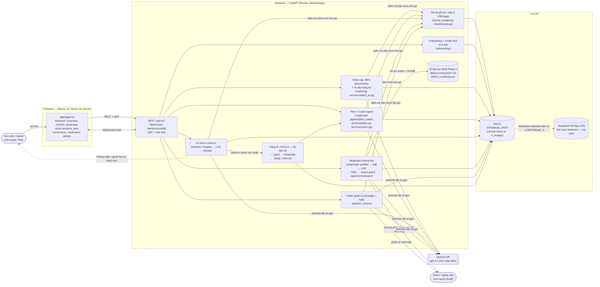

# Kiến trúc PeerBridge (EDU-07)

> Tài liệu này mô tả kiến trúc PeerBridge trên nhánh nộp bài. Đường dẫn trong ngoặc là nơi code nằm.
> Mục "Chưa có" ghi rõ những gì **không** tồn tại để người đọc không hiểu nhầm.

Phạm vi nội dung demo hiện tại là **AICB Phase 1** (`course_id=aicb`, 15 file học liệu). Catalog còn concept
SQL/Python từ giai đoạn thử nghiệm, nhưng chưa có pilot người dùng thật trên các môn đó.

## 1. Sơ đồ tổng thể

## 2. Thành phần và luồng dữ liệu

| Thành phần | Code | Đầu vào → đầu ra | Gọi OpenAI? |
|---|---|---|---|
| Frontend | `frontend/app/page.tsx`, `frontend/features/*`, `frontend/lib/*` | Một trang (SPA) gọi REST bằng JWT; phòng học dùng WebSocket | Không trực tiếp |
| Auth | `backend/app/routers/auth.py`, `security.py` | Email + mật khẩu → JWT HS256 (`JWT_SECRET`), mật khẩu hash PBKDF2 | Không |
| Onboarding (Data 1) | `backend/app/onboarding/` | Chủ đề người học gõ → concept chuẩn trong `data/concepts/catalog.json` (lexical + luật; LLM tuỳ chọn) | Tuỳ chọn |
| Ghép cặp (Data 1) | `backend/app/matching/`, `services/match_ai.py`, `loop/ai_clients.py` | Hồ sơ + lịch rảnh → điểm deterministic → (nếu `MATCH_RERANK_ENABLED=true`) LLM xếp hạng lại; lỗi/ hết trần thì giữ thứ tự công thức | Có (tuỳ chọn) |
| Plan + Coach (Data 2) | `backend/app/agents/plan_coach/`, `services/plans.py`, `services/coach.py` | Mục tiêu + giờ rảnh 2 bạn → LLM chia việc theo concept → scheduler/validator xếp lịch; coach chọn hành động (giảm tải, nhắc, hẹn phiên) có giới hạn 1 lần/người/ngày, không nhắc 22h–7h | Có (`PLAN_LLM_PROVIDER`) |
| AI Vision check-in | `backend/app/checkin/` | Ảnh (JPEG/PNG/WEBP/HEIC) → chuẩn hoá, bỏ EXIF, cạnh ≤1568px (`imaging.py`) → LLM mô tả + concept + độ tin cậy → `decision.py` tự đánh dấu xong / hỏi lại / để người dùng chọn | Có (`VISION_LLM_PROVIDER`) |
| Vòng AI | `backend/app/loop/`, `backend/app/metrics/` | Check-in được ghi nhận → tính nhịp học (Data 1) → coach (Data 2) → chuông thông báo (`home/notifications.py`); chạy theo chu kỳ `LOOP_INTERVAL_MINUTES` | Gián tiếp (coach) |
| Moderator phòng học | `backend/app/agents/moderator/`, `services/study_room.py` | Tin nhắn → prefilter (tin xã giao ngắn bỏ qua LLM) → luật cứng/mềm → LLM phân loại → chọn action ALLOW/GUIDE/WARN/BLOCK/ESCALATE → GUIDE thì lấy slide bằng BM25 → sinh gợi ý Socratic → output guard. Tin chỉ được phát cho phòng sau khi duyệt xong | Có (`LLM_PROVIDER`) |
| RAG | `agents/moderator/local_retriever.py`, `data/courses/aicb/` | 15 file học liệu AICB Phase 1 (.md) → chunk → BM25, lọc theo `course_id`; nội dung bài được đưa vào prompt như **dữ liệu**, không phải chỉ dẫn | Không (truy xuất chạy local) |
| Chấm phiên | `backend/app/session_review/` | Bản ghi phiên → luật + LLM-judge: có lộ đáp án không, mức Socratic; số liệu cho trang Admin | Có (nếu còn trần) |
| Sổ chi phí AI | `loop/ai_budget.py`, `checkin/stats.py` | Mọi lần gọi LLM ghi token/USD vào bảng `ai_usage`/`vi_*`; tổng mỗi ngày so với `VISION_DAILY_BUDGET_USD` (mặc định 2 USD) | — |
| Lưu trữ | `backend/app/db.py` (sqlite3), `checkin/db.py` (SQLAlchemy cho bảng `vi_*`) | Một file SQLite; ảnh check-in lưu trong DB (`VISION_STORAGE_BACKEND=db`) | — |
| Sao lưu | `backend/start.sh`, `backend/litestream.yml` | Có đủ `LITESTREAM_*` thì khôi phục DB khi khởi động và sao lưu liên tục lên Supabase Storage | — |

### Luồng chính (demo)

1. Đăng nhập (hoặc nút tài khoản demo khi `DEMO_MODE=true`).
2. Tìm bạn học → gửi/chấp nhận lời mời → thành cặp (`peer_matches`).
3. Lập kế hoạch tuần: AI chia việc theo concept, scheduler đặt vào giờ rảnh của từng người.
4. Học xong → chụp ảnh check-in → AI Vision nhận concept → xác nhận mục trong plan.
5. Vòng AI đo nhịp học, coach gợi ý nếu một bạn chậm; bạn cặp nhận chuông và thả cảm xúc.
6. Phòng học chat realtime có moderator Socratic; Admin xem tin bị cảnh báo và số liệu AI.

## 3. Hạ tầng triển khai (đang chạy)

| Phần | Nơi chạy | Ghi chú |
|---|---|---|
| Frontend | Vercel, https://peerbridge-deploy.vercel.app | Gói Hobby, build từ repo deploy riêng của Tú (xem `docs/DEPLOY.md`) |
| Backend | Render (gói Free), https://peerbridge-api-4fht.onrender.com/health | `render.yaml`; ngủ sau 15 phút không dùng |
| CSDL | SQLite trên đĩa tạm của Render | Mất dữ liệu khi khởi động lại nếu chưa cấu hình Litestream |
| LLM | OpenAI | Model mặc định `gpt-4.1-mini` cho mọi phần |

## 4. Chưa có / giới hạn đã biết

- Không dùng PostgreSQL ở runtime: `DATABASE_URL` chỉ dùng cho Alembic/SQLAlchemy, các repository dùng `sqlite3`.
- Qdrant + embedding E5 có code (`qdrant_retriever.py`) nhưng bản chạy thật dùng BM25 local (`RETRIEVER_PROVIDER=local`).
- WebSocket phòng học giữ kết nối trong bộ nhớ một tiến trình → chỉ chạy 1 instance backend.
- Thư mục `src/`, `Dockerfile`, `docker-compose.yml`, `Makefile` ở gốc là **template của BTC**, không phải ứng dụng PeerBridge. Image thật: `backend/Dockerfile.render`, `frontend/Dockerfile.render`.
