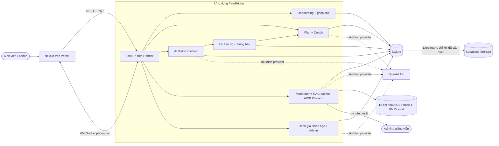

# Sơ đồ kiến trúc — PeerBridge (P-005, EDU-07)

File này khôi phục đường dẫn **gốc của template BTC**. Chi tiết thành phần, luồng dữ liệu, cấu hình và giới hạn nằm trong [tài liệu kiến trúc đầy đủ](architecture.md).

## Thành phần chính

| Thành phần | Vai trò và nơi đặt mã |
|---|---|
| Giao diện | `frontend/app/`, `frontend/features/`: ghép cặp, kế hoạch, check-in, phòng học và quản trị |
| API | `backend/app/main.py`, `routers/`, `services/`, `repositories/`: xác thực, nghiệp vụ và WebSocket |
| AI | `backend/app/agents/`, `checkin/`, `loop/`: LangGraph moderator/coach, nhận ảnh, đo tiến độ và giới hạn chi phí |
| Dữ liệu | SQLite tại `DATABASE_PATH`; ảnh check-in mặc định lưu trong DB; 15 bài học AICB Phase 1 trong `backend/data/courses/aicb/` |
| Sao lưu | `backend/start.sh`, `backend/litestream.yml`: chỉ hoạt động khi đủ cấu hình `LITESTREAM_*`; bản demo hiện chưa bật |

Frontend chỉ gọi backend; khóa AI nằm ở backend. Bản live Render Free dùng đĩa tạm, vì vậy dữ liệu có thể mất sau khi server khởi động lại cho đến khi bật và kiểm tra khôi phục sao lưu.
