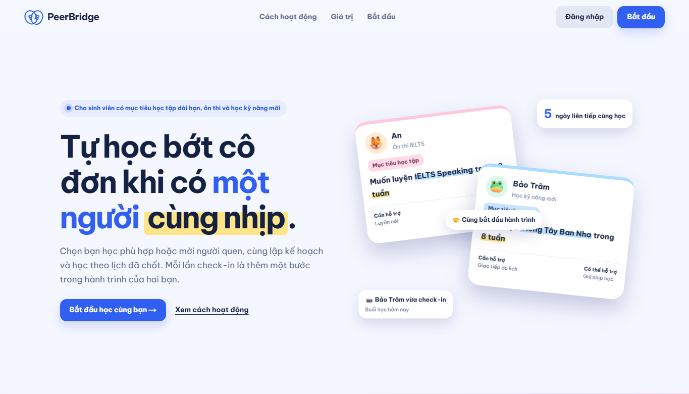
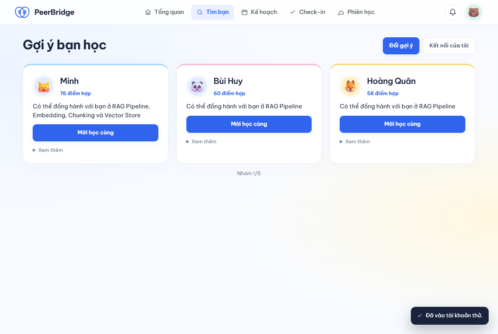
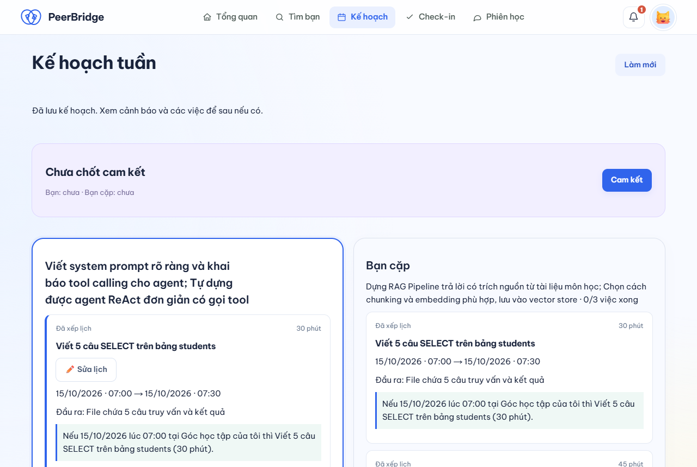
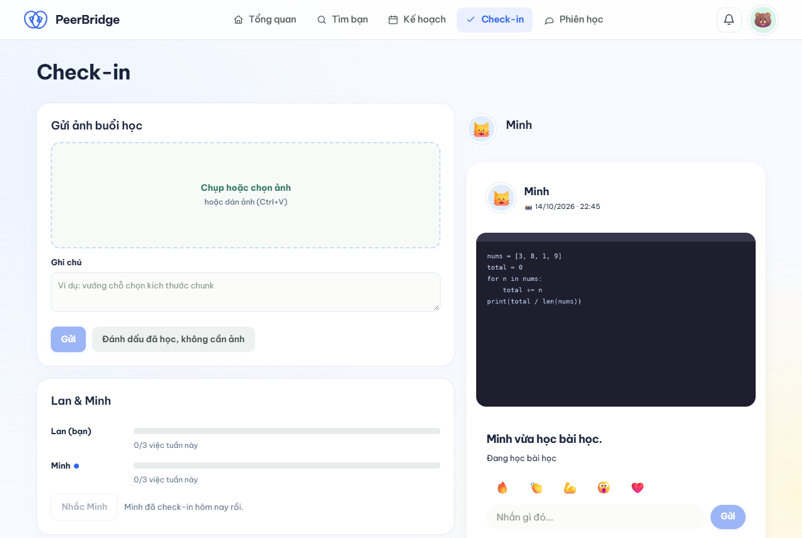

<!-- Nguồn của docs/pitch-deck.pdf và presentation/pitch_deck.pptx.
     Dựng lại bằng Marp CLI 4.0.3; số liệu CI ghi rõ commit/lần chạy trong báo cáo đánh giá. -->

# PeerBridge

## Học cùng nhau, tiến xa hơn

Đề EDU-07 · Nhóm P-005 · AI20K Cohort 4

---

## Vấn đề

- Tự học AICB Phase 1 **dễ bỏ dở**
- Không ai cùng nhịp, nhắc nhở
- Nhóm chat thành chỗ **xin đáp án**

[CẦN SỐ THẬT: khảo sát]

---

## Giải pháp

- Ghép **cặp bổ trợ**
- AI lập **kế hoạch tuần**
- **Check-in** bằng ảnh
- Coach nhắc đúng lúc

---

## Demo

peerbridge-deploy.vercel.app

---

## Kiến trúc

- Next.js (Vercel) → **FastAPI** (Render)
- SQLite, sao lưu Litestream (**chưa bật**)
- OpenAI gpt-4.1-mini
- Mọi AI chung **trần 2 USD/ngày**

Sơ đồ đầy đủ: docs/architecture.md

---

## Công nghệ

- Next.js 16 + React 19 (Vercel)
- FastAPI + Python 3.12 (Render)
- LangGraph + OpenAI gpt-4.1-mini
- BM25 trên 15 bài học AICB Phase 1

AI đề xuất · code kiểm · người chốt

---

## Kết quả kiểm thử

- **972** test backend · coverage **90.21%**
- Moderator: **0** lỗi nghiêm trọng/72 tin
- Red-team: **10/10** ca
- E2E luồng chính + Docker build qua CI

CI PR #40 ngày 16/10 · Bộ đánh giá AI là dữ liệu tổng hợp

---

## Người dùng và phạm vi

- Mục tiêu: học viên AICB Phase 1 học theo cặp
- Nội dung demo: 15 bài học Phase 1
- **Chưa** thử nghiệm với người dùng thật
- **Chưa** có số khảo sát để ước lượng thị trường

Video demo: xem tài liệu nộp bài (chưa có URL)

---

## Đội ngũ

- **Chính**: ghép cặp, tiến độ
- **Sang**: kế hoạch, coach
- **Tú**: Vision, moderator, deploy
- **Hiệp**: UX/UI và phần nền

---

## Cần hỗ trợ tiếp

- Mời sinh viên thử sản phẩm và góp ý
- Thu ảnh học tập có đồng ý để đánh giá Vision
- Bật sao lưu trước khi pilot có dữ liệu thật

Còn phải nộp: video ≤5 phút, ≥5 phản hồi thật

